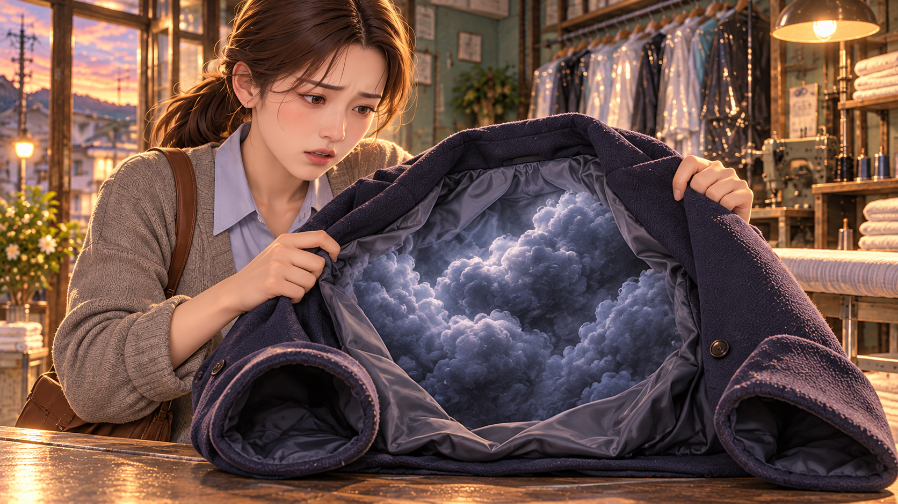
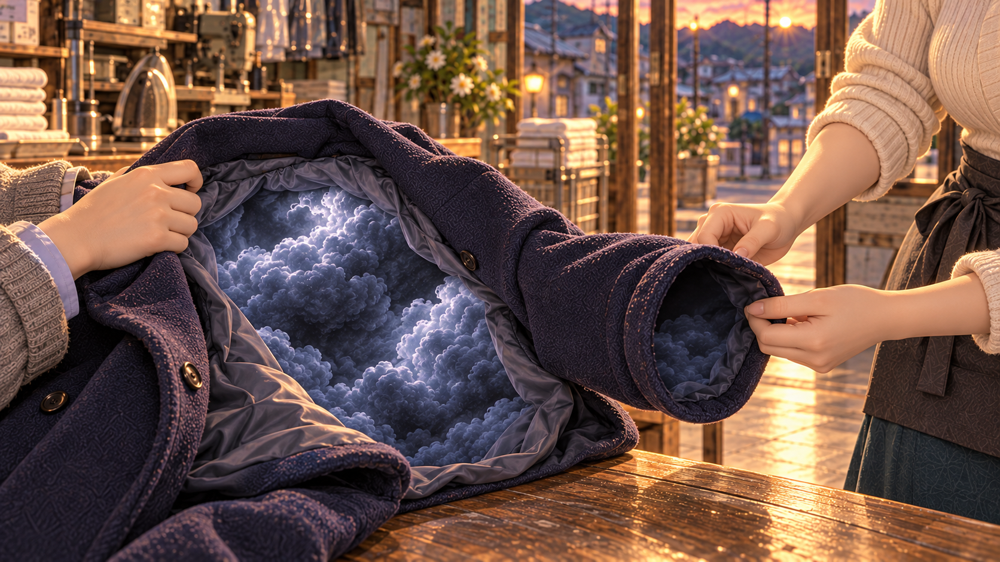
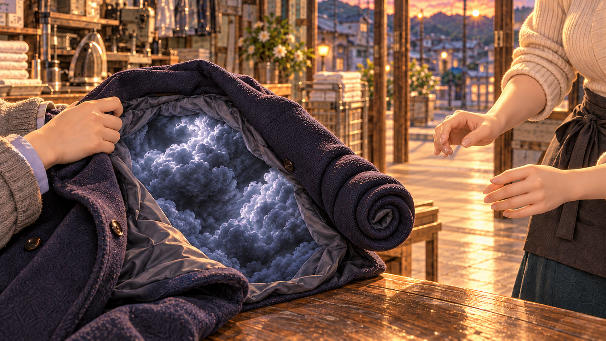
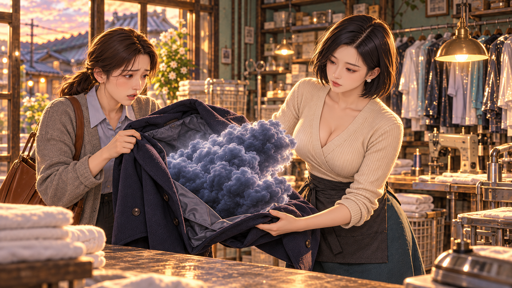
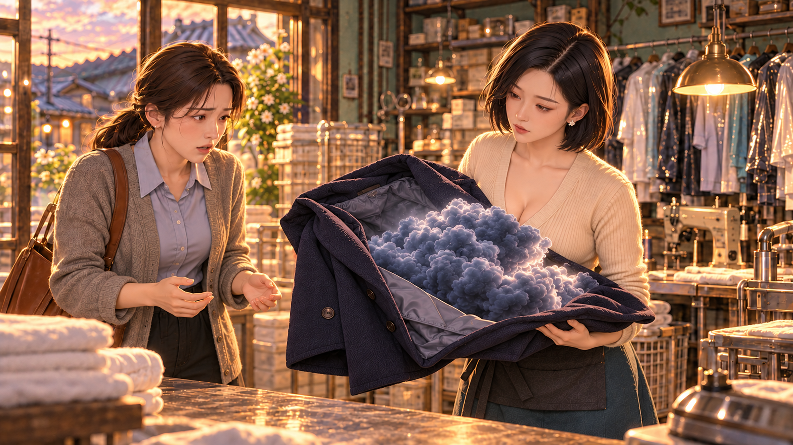
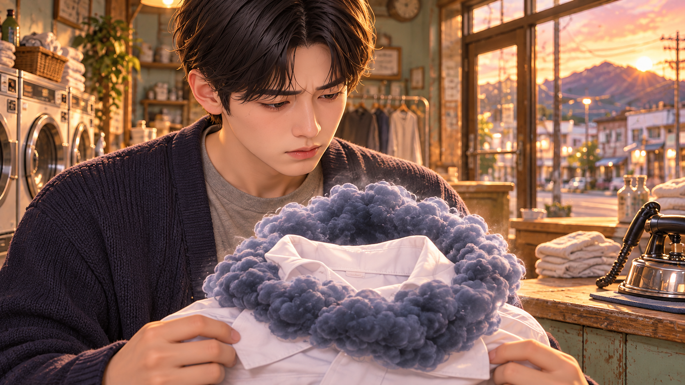
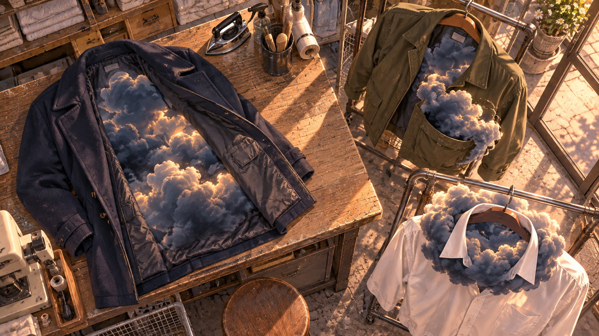

# 비우고 · 01–12컷

[전체 목록](../README.md)

## V6_C001 · 문종이 울린다
0.000–2.333초 · 문종 익스트림 클로즈업
손님이 문을 밀자 작은 종이 흔들린다. 소매와 가방끈만 프레임을 스친다.

| 시작 | 종료 |
| --- | --- |
|  | 시작 이미지 공용 |

## V6_C002 · 안감 밖으로 부푼 무게
2.333–6.200초 · 코트 중심 타이트 미디엄·지안 얼굴은 위쪽 일부
지안이 팔에 든 빈 코트의 안감에서 쿠션 크기 짙은 청회색 구름이 부푼다. 소매는 안쪽으로 둥글게 말려 있고 그녀의 손은 끝을 꽉 쥔다.

| 시작 | 종료 |
| --- | --- |
|  | 시작 이미지 공용 |

## V6_C003 · 손을 떼자 다시 말리는 소매
6.200–10.400초 · 두 사람의 손과 코트 소매 미디엄 클로즈업
아직 지안이 코트를 받친 상태에서 서온이 말린 소매 끝을 펴 본다. 손을 떼자 소매가 스스로 다시 오므라든다. 지안이 놀라 손을 멈추고 서온은 차분하게 받쳐준다.

| 시작 | 종료 |
| --- | --- |
|  |  |

## V6_C004 · 아직 놓기 어려운 손
10.400–14.900초 · 눈높이 미디엄 투숏
서온이 부푼 코트를 두 손으로 받친다. 지안은 말린 끝을 잠깐 더 쥐다가 손을 놓는다. 구름은 옷에 붙어 있고 사람 몸으로 옮겨가지 않는다.

| 시작 | 종료 |
| --- | --- |
|  |  |

## V6_C005 · 안감에 걸린 덩어리
14.900–18.933초 · 서온 어깨 너머 코트 디테일
서온 어깨 너머 열린 안감. 바느질선에 걸린 짙은 구름 덩어리가 천을 둥글게 밀고 있어 빈 코트가 과하게 두껍다. 서온이 접힌 부분을 살피며 손을 멈춘다.

| 시작 | 종료 |
| --- | --- |
|  | 시작 이미지 공용 |

## V6_C006 · 세탁소의 박자
18.933–22.300초 · 가게 전체 와이드
지안은 문 쪽으로 나가고, 서온은 카운터를 돌며 옷걸이와 작업대를 오간다. 가게의 문·작업대·마당 동선이 보인다.

| 시작 | 종료 |
| --- | --- |
|  |  |

## V6_C007 · 시장에서 온 사람
22.300–25.933초 · 문밖에서 보는 롱숏
도식이 올리브 점퍼를 들고 들어온다. 빈 오른쪽 주머니에서 큰 청회색 구름 덩어리가 반쯤 튀어나와 주머니와 밑단을 아래로 심하게 끌어내린다. 그는 양팔로 무게를 받친다.

| 시작 | 종료 |
| --- | --- |
|  |  |

## V6_C008 · 빈 주머니가 왜 무거울까
25.933–30.433초 · 도식 얼굴에서 주머니로 짧은 틸트
도식이 점퍼 주머니의 늘어난 천을 들어 보지만 구름의 무게 때문에 다시 처진다. 물건을 꺼내는 대신 구름이 주머니 밖으로 부풀어 나와 있음을 보여준다.

| 시작 | 종료 |
| --- | --- |
|  |  |

## V6_C009 · 스스로 조여드는 깃
30.433–33.500초 · 손 높이 인서트
민재가 꺼낸 빈 흰 셔츠의 깃 주위에 굵은 청회색 구름 고리가 감겨 있다. 고리가 스스로 오므라들며 흰 깃을 찌그러뜨린다. 민재는 셔츠 끝을 당겨 펴려 한다.

| 시작 | 종료 |
| --- | --- |
|  |  |

## V6_C010 · 눈을 들지 못하는 손님
33.500–36.666초 · 민재 얼굴 클로즈업
민재가 눈을 내리고 셔츠를 건넨다. 프레임 아래에는 조여든 흰 깃과 굵은 구름 고리가 걸려 있다. 그는 풀리지 않는 옷과 서온의 얼굴을 번갈아 본다.

| 시작 | 종료 |
| --- | --- |
|  | 시작 이미지 공용 |

## V6_C011 · 알아주는 눈
36.666–39.300초 · 민재 어깨 너머 서온 미디엄
서온이 셔츠 아래를 받치며 고개를 끄덕인다. 민재가 손을 뗀 뒤에도 고리는 깃을 조이고 있다. 서온은 잡아당기지 않고 접힌 결을 살핀다.

| 시작 | 종료 |
| --- | --- |
|  |  |

## V6_C012 · 모양이 다른 세 가지 무게
39.300–42.100초 · 작업대 탑숏
남색 코트는 안감이 부풀고, 올리브 점퍼는 오른쪽 주머니가 처지고, 흰 셔츠는 깃이 구름 고리에 조여 있다. 작업대와 옆 행거의 세 위치가 분명하게 나뉜다.

| 시작 | 종료 |
| --- | --- |
|  | 시작 이미지 공용 |
