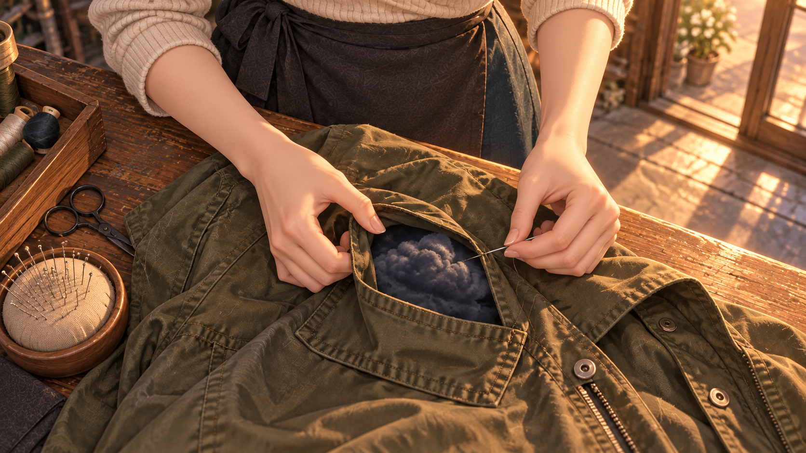

# 비우고 · 13–24컷

[전체 목록](../README.md)

## V6_C013 · 몸에 밴 동선
42.100–47.466초 · 작업대 옆 미디엄 롱숏·짧은 측면 이동
서온이 셔츠를 펴기 위해 작업대 집게를 옮기고 다리미를 준비한다. 조여드는 깃을 억지로 당기지 않고 넓게 받친다. 손과 어깨에 익숙한 작업 리듬이 있다.

| 시작 | 종료 |
| --- | --- |
|  |  |

## V6_C014 · 고리를 펴는 한 번의 통과
47.466–50.266초 · 다리미·손 클로즈업
서온이 셔츠 깃을 받쳐 펴며 다리미를 한 번 민다. 굵은 구름 고리 한쪽이 열리고 깃에서 떨어져 작업대 위로 떠오른다. 흰 깃이 정상 모양으로 돌아온다.

| 시작 | 종료 |
| --- | --- |
|  |  |

## V6_C015 · 자기도 모르게 쥐는 손
50.266–54.666초 · 옆구리·앞치마 손 디테일
다음 작업을 보던 서온이 자기 앞치마를 구겨 쥔다. 접힌 곳에서 손 두 개 크기의 짙은 구름이 둥글게 불거져 나온다. 서온은 아직 자기 옷을 보지 못한다.

| 시작 | 종료 |
| --- | --- |
|  |  |

## V6_C016 · 식어가는 차
54.666–56.966초 · 찻잔·시계 인서트
찻잔의 김이 거의 사라지고 옆에는 남은 일감이 놓여 있다. 서온의 손은 잔을 지나 다음 작업을 고른다.

| 시작 | 종료 |
| --- | --- |
|  | 시작 이미지 공용 |

## V6_C017 · 집게 하나의 박자
56.966–61.500초 · 손·집게 타이트 인서트
고리가 빠져나가 깃이 펴진 흰 셔츠를 집게로 건다. 정상적인 깃과 옷의 가벼운 흔들림을 짧게 보여준다. 빠져나온 구름은 작업대 흰 천 위에 머문다.

| 시작 | 종료 |
| --- | --- |
|  |  |

## V6_C018 · 해진 곳을 잇는 손
61.500–65.133초 · 수선 손 탑숏
서온이 무거운 구름 아래의 점퍼 주머니를 받치고 해진 끝을 수선한다. 마지막 바늘땀을 당길 때 주머니를 붙잡던 구름의 결이 느슨해진다.

| 시작 | 종료 |
| --- | --- |
|  |  |

## V6_C019 · 주머니가 제자리로 돌아오다
65.133–69.666초 · 작업대 측면 미디엄
수선한 점퍼를 다리는 손길에 큰 구름 덩어리가 주머니 밖으로 들어 올려진다. 오른쪽 주머니와 밑단이 정상 높이로 돌아온다.

| 시작 | 종료 |
| --- | --- |
|  |  |

## V6_C020 · 세 번째 덩어리
69.666–72.566초 · 코트 안감과 두 손 중심 미디엄
서온이 부풀었던 코트의 안감 주름을 넓게 펴자 쿠션 크기 구름이 옷에서 빠져나온다. 옆의 흰 천 위에는 먼저 풀려난 고리와 주머니 구름이 각각 하나씩 머문다.

| 시작 | 종료 |
| --- | --- |
|  |  |

## V6_C021 · 바람 쪽으로
72.566–75.300초 · 마당 문턱 와이드
마당 문 앞. 세 덩어리를 감싼 흰 천을 두 손으로 받쳐 든 서온이 선다. 정상화된 코트는 옆 빨랫줄에 한 벌만 걸려 있다.

| 시작 | 종료 |
| --- | --- |
|  | 시작 이미지 공용 |

## V6_C022 · 크게 펼치는 흰 천
75.300–78.700초 · 마당 측면 미디엄 롱숏
서온이 흰 천을 넓게 펼친다. 천 위의 세 구름은 둥근 윤곽을 유지한 채 옅어지기 시작한다. 천의 그늘과 짙은 구름이 분명하게 구분된다.

| 시작 | 종료 |
| --- | --- |
|  |  |

## V6_C023 · 툭, 바람에 놓기
78.700–83.933초 · 같은 축의 넓은 마당 와이드
천을 한 번 털자 세 구름이 천에서 떨어져 바람을 탄다. 덩어리가 길게 펴졌다가 밝은 김과 꽃잎으로 흩어진다. 천과 옷은 비어 가벼워진다.

| 시작 | 종료 |
| --- | --- |
|  |  |

## V6_C024 · 멀어지는 것들
83.933–88.366초 · 담장 아래에서 하늘로 짧은 틸트
풀려난 세 기운이 담장 위로 올라 자연 구름 쪽으로 옅어진다. 옷에 붙어 있던 부피가 줄어 사라지는 끝을 본다.

| 시작 | 종료 |
| --- | --- |
|  |  |
