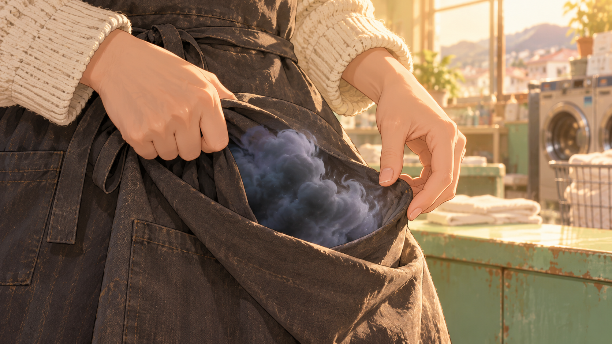

# 비우고 · 35–43컷

[전체 목록](../README.md)

## V6_C035 · 다 끝내야 한다는 마음
129.966–134.600초 · 서온 등 너머 남은 일감 미디엄
서온이 남은 옷과 접수표를 차례로 보며 다시 손을 뻗는다. 빈 의자 쪽 시선을 바로 거둔다.

| 시작 | 종료 |
| --- | --- |
|  |  |

## V6_C036 · 자기 앞치마의 주름
134.600–139.833초 · 손·앞치마 타이트 인서트
서온이 꽉 쥔 앞치마 접힘에서 짙은 구름 덩어리가 둥글게 불거진다. 손이 더 조일수록 천의 부피가 단단해진다. 처음으로 서온의 시선이 자기 손에 내려간다.

| 시작 | 종료 |
| --- | --- |
|  |  |

## V6_C037 · 문을 잡아주는 손님
139.833–142.533초 · 서온 시점 문턱 미디엄
민재가 바쁜 서온을 보고 문을 잡아준다. 바람이 들어와 앞치마 가장자리를 흔들지만, 그녀가 쥔 덩어리는 손을 놓기 전까지 그대로다.

| 시작 | 종료 |
| --- | --- |
|  | 시작 이미지 공용 |

## V6_C038 · 나도 놓아도 되겠구나
142.533–146.000초 · 36컷과 대응하는 앞치마·손 클로즈업
서온이 손의 힘을 빼고 앞치마를 편다. 둥근 구름 덩어리가 천에서 떨어져 들어온 바람을 타고 풀린다. 구겨졌던 천이 평평해진다.

| 시작 | 종료 |
| --- | --- |
|  |  |

## V6_C039 · 숨이 풀리는 얼굴
146.000–151.633초 · 눈높이 얼굴 클로즈업·아주 느린 접근
서온이 길게 숨을 내쉰다. 긴장한 턱이 풀리고 눈을 뜨며 편안하게 웃는다.

| 시작 | 종료 |
| --- | --- |
|  |  |

## V6_C040 · 하늘 쪽으로
151.633–155.933초 · 일반 읍내 지붕·푸른 하늘 와이드
작은 김 한 줄기가 자연 구름으로 사라진다. 낮은 지붕 위 하늘이 넓게 열린다.

| 시작 | 종료 |
| --- | --- |
|  | 시작 이미지 공용 |

## V6_C041 · 두 손은 비고
155.933–159.400초 · 서온 손 시점 셔츠 반환 인서트
서온이 구름 고리가 완전히 사라지고 깃이 펴진 흰 셔츠를 민재에게 건넨다. 그녀의 빈 손과 자연스럽게 펴진 깃이 함께 보인다.

| 시작 | 종료 |
| --- | --- |
|  |  |

## V6_C042 · 곧아지는 어깨
159.400–162.666초 · 민재 미디엄 클로즈업
민재가 깃을 펴 보지만 더는 되말리지 않는다. 놀라 확인한 뒤 숨을 고르고 어깨를 편다. 서온을 똑바로 본다.

| 시작 | 종료 |
| --- | --- |
|  |  |

## V6_C043 · 돌아서서 웃는 인사
162.666–167.200초 · 가게 안에서 문밖을 보는 롱숏
민재가 정상적인 흰 셔츠를 천 가방에 담아 나간다. 돌아서서 환하게 웃고 손을 흔든다. 서온은 문 안에서 답한다.

| 시작 | 종료 |
| --- | --- |
|  |  |
