# 01–10컷 시작·종료 이미지

[전체 자료](README.md)

## H001 · 평범한 저녁
00:00.000–00:03.000
여자는 소파에서 휴대폰, 남자는 TV 앞 게임 준비. 서로 다른 쪽에 있지만 발끝은 살짝 닿아 있다.

| START | END |
| --- | --- |
| 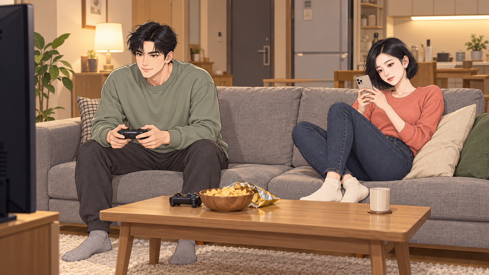 | START 공용 |

## H002 · 게임에는 관심 없음
00:03.000–00:06.000
남자가 여분 패드를 여자 쪽으로 밀자 여자는 보지도 않고 쿠션을 그 자리에 놓는다.

| START | END |
| --- | --- |
| 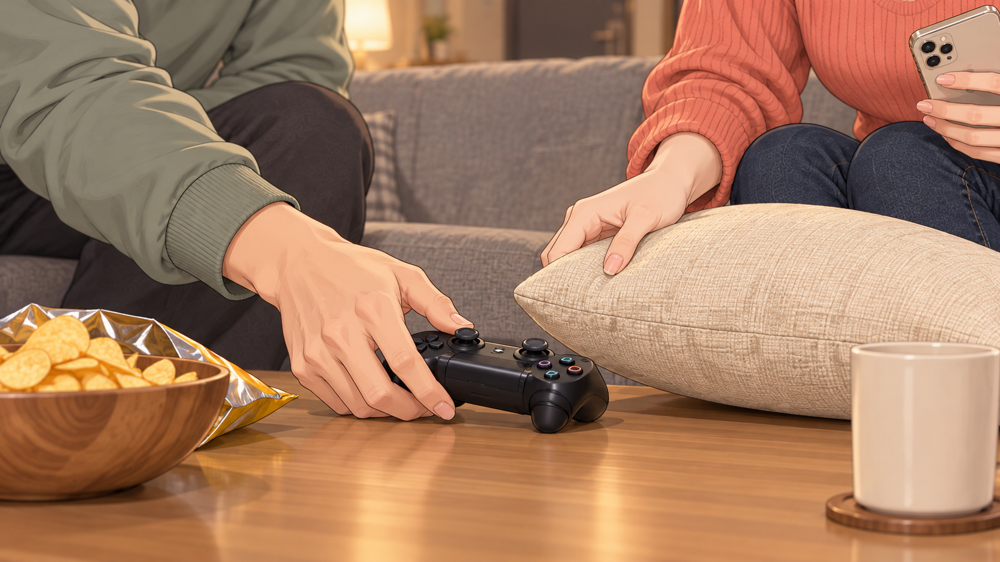 | 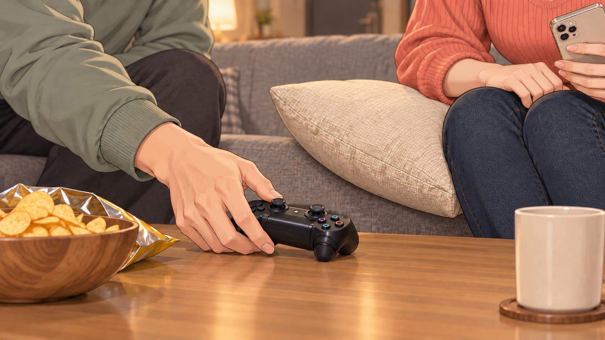 |

## H003 · 쇼핑에도 관심 없음
00:06.000–00:09.000
다른 날. 여자가 옷 두 벌을 들어 보이는데 남자는 고개만 끄덕이다 졸아 버린다.

| START | END |
| --- | --- |
| 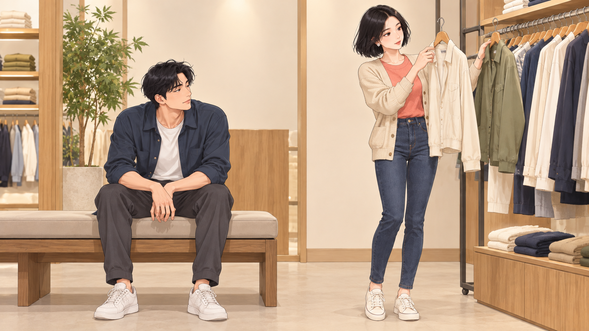 | 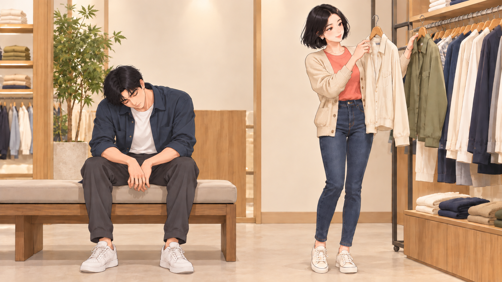 |

## H004 · 낚시를 왜 해
00:09.000–00:12.000
또 다른 날. 여자는 접은 팔과 지루한 발끝, 남자는 찌를 진지하게 본다. 빈 살림망을 여자가 발로 툭 건드린다.

| START | END |
| --- | --- |
| 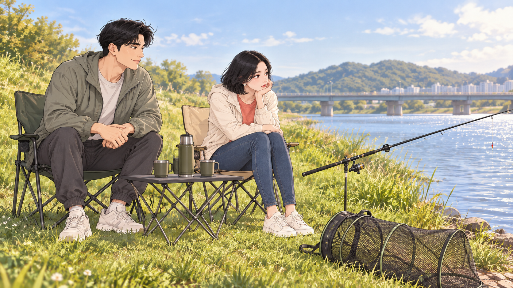 | START 공용 |

## H005 · 누가 먼저 빠질까
00:12.000–00:15.233
처음 거실로 복귀. 남자가 물을 가지러 나가고 패드를 소파에 둔다. 여자 눈만 패드 쪽으로 움직인다.

| START | END |
| --- | --- |
| 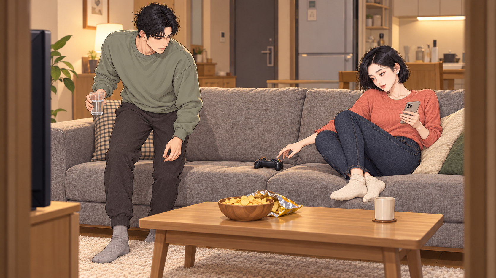 | 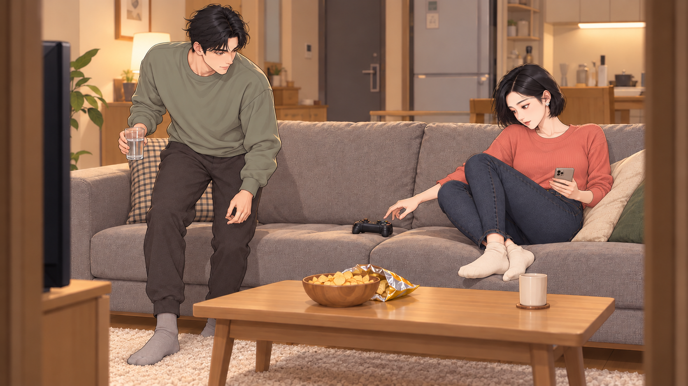 |

## H006 · 좋아서 만난 사이
00:15.233–00:20.733
남자가 출발 전 여자 머리에 붙은 작은 먼지를 떼 준다. 여자는 무심한 척 웃고 다시 휴대폰을 본다.

| START | END |
| --- | --- |
| 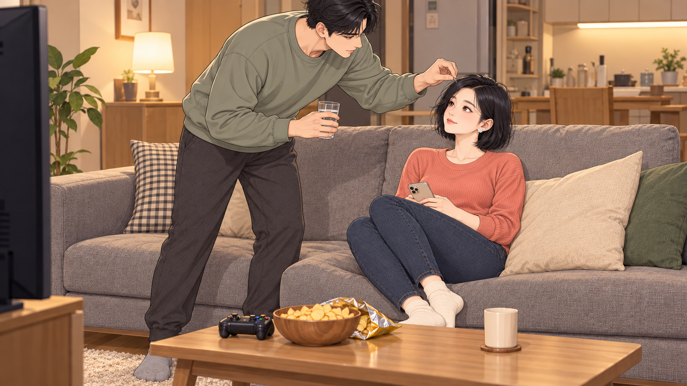 | 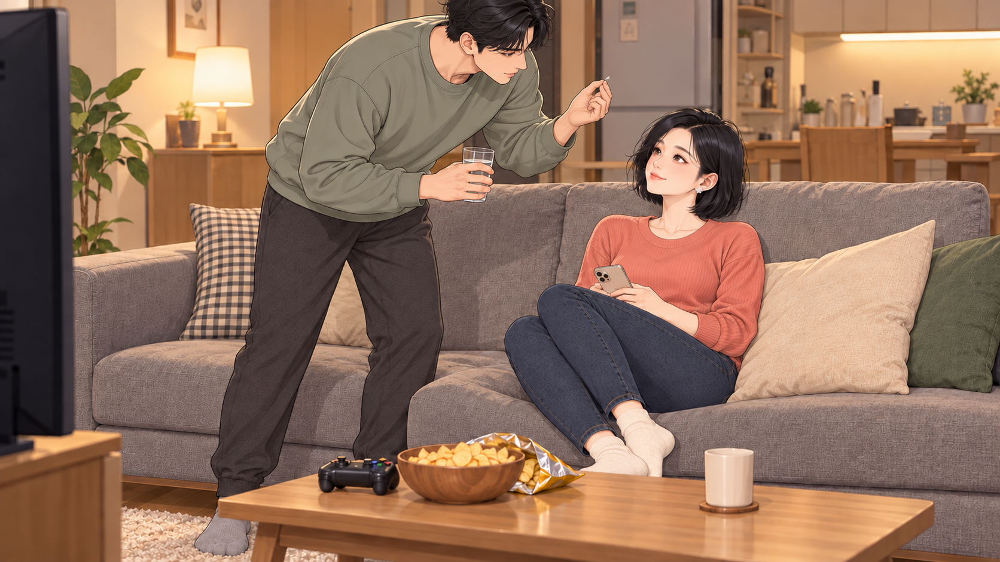 |

## H007 · 같을 수는 없잖아
00:20.733–00:25.833
빈자리와 놓인 패드를 보던 여자가 TV를 한 번, 문을 한 번 확인한다. 손끝이 패드에 다가간다.

| START | END |
| --- | --- |
| 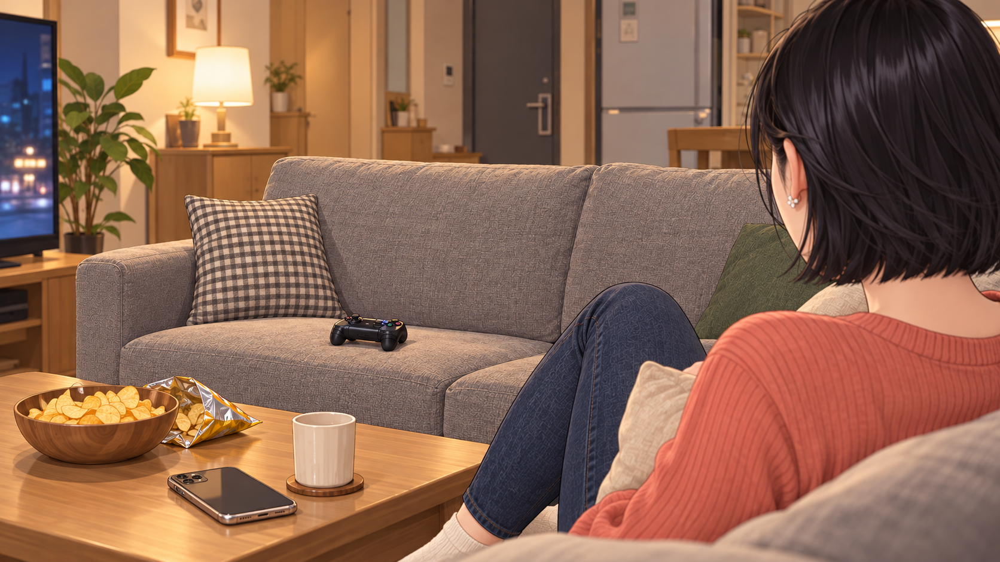 | 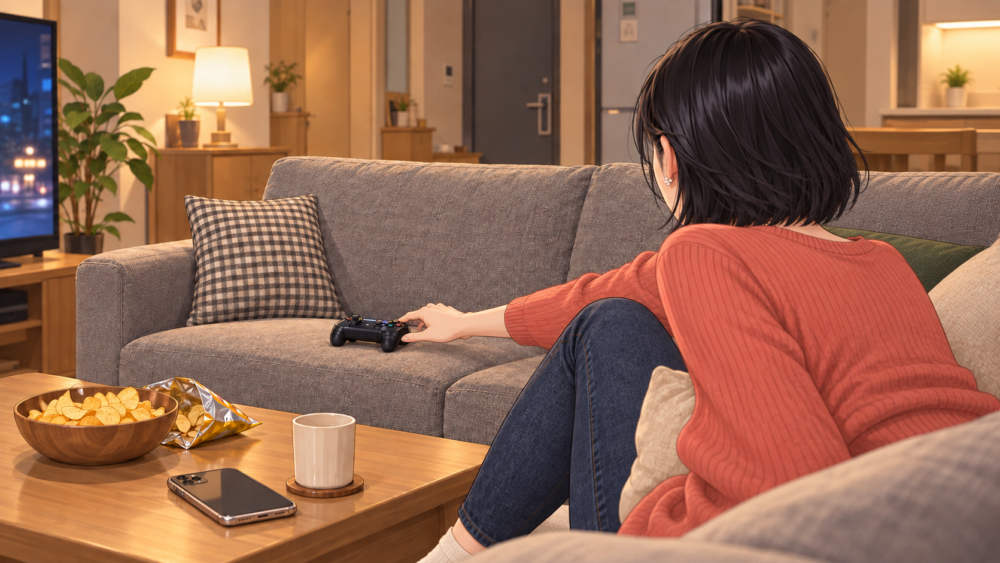 |

## H008 · 한 번만
00:25.833–00:28.133
검지 하나로 버튼을 누른다. 화면 속 단순 블록 캐릭터가 엉뚱한 방향으로 점프한다.

| START | END |
| --- | --- |
|  | 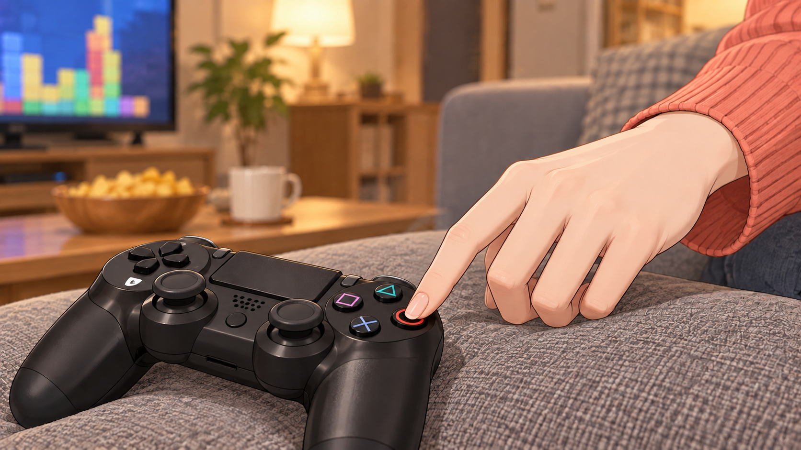 |

## H009 · 시시한 척
00:28.133–00:31.200
입꼬리만 비웃다가 화면 실패에 눈썹이 올라간다. 패드를 양손으로 고쳐 쥔다.

| START | END |
| --- | --- |
| 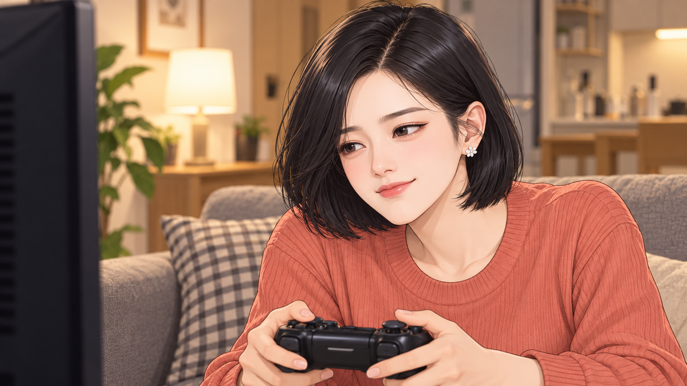 | 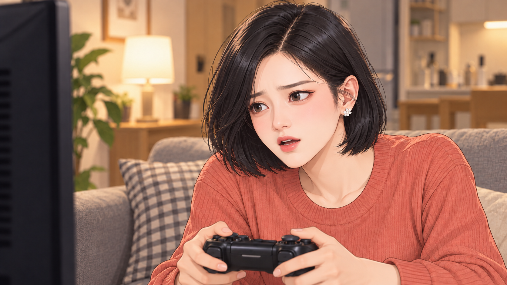 |

## H010 · 벌써 진심
00:31.200–00:34.700
기대 앉았던 몸이 앞으로 쏠린다. 발이 바닥에 단단히 붙고 쿠션이 옆으로 밀려난다.

| START | END |
| --- | --- |
| 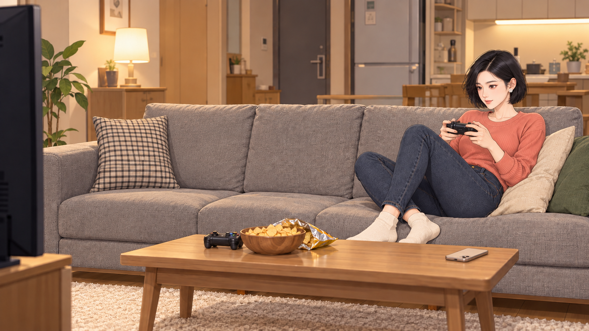 | 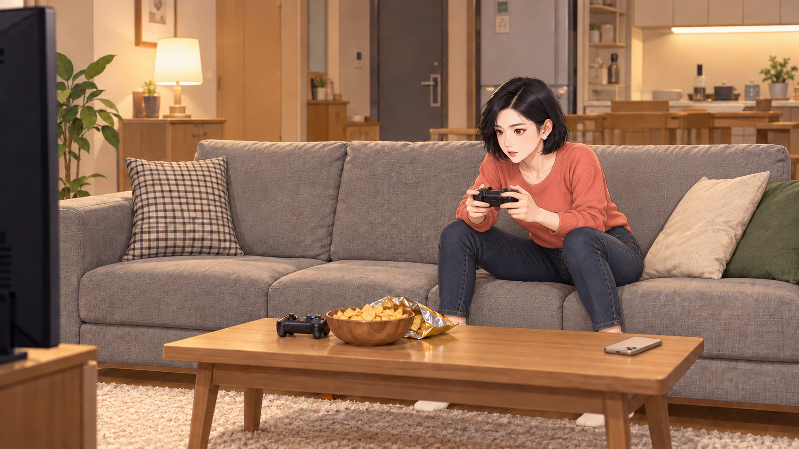 |
