# 21–30컷 시작·종료 이미지

[전체 자료](README.md)

## H021 · 나도 하고
01:00.566–01:03.233
쇼핑 날 여자가 남자 무릎 위에 재킷을 툭 놓는다. 남자가 됐다는 손짓을 하다 옷감을 만져 본다.

| START | END |
| --- | --- |
| 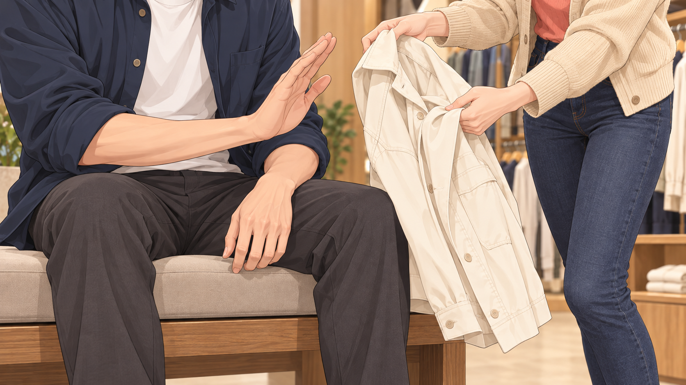 | 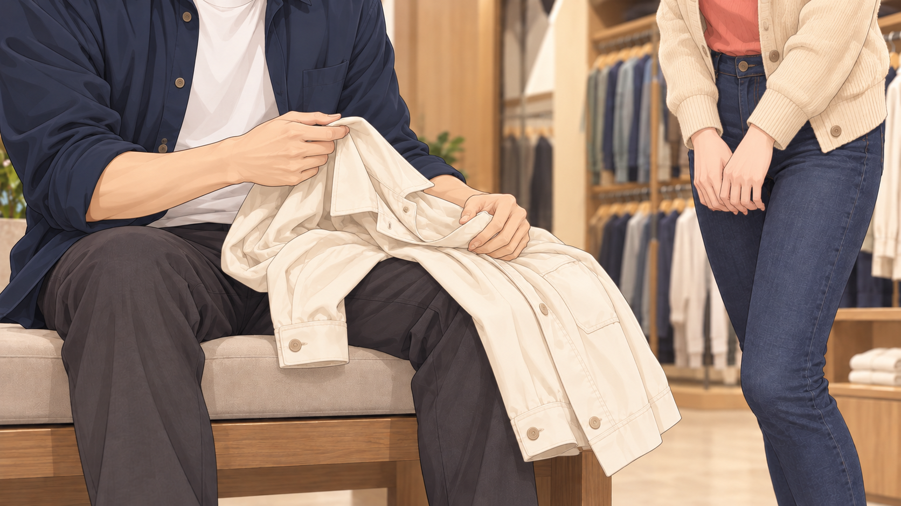 |

## H022 · 사이좋게 살자고
01:03.233–01:07.866
남자가 재킷을 입고 무심하게 보다가 어깨를 한 번 돌린다. 거울 안 자기 모습에 작게 만족한다.

| START | END |
| --- | --- |
| 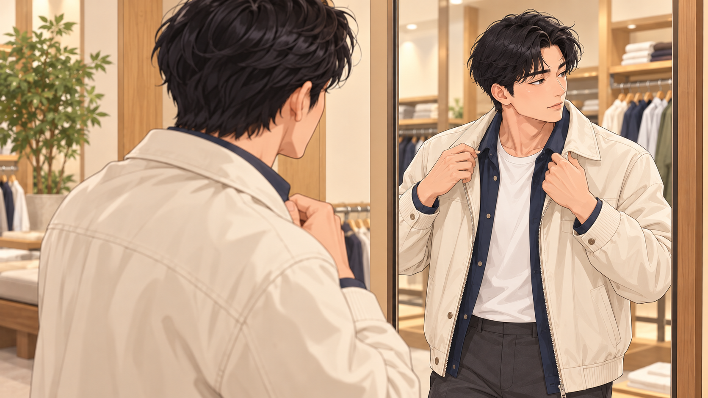 | 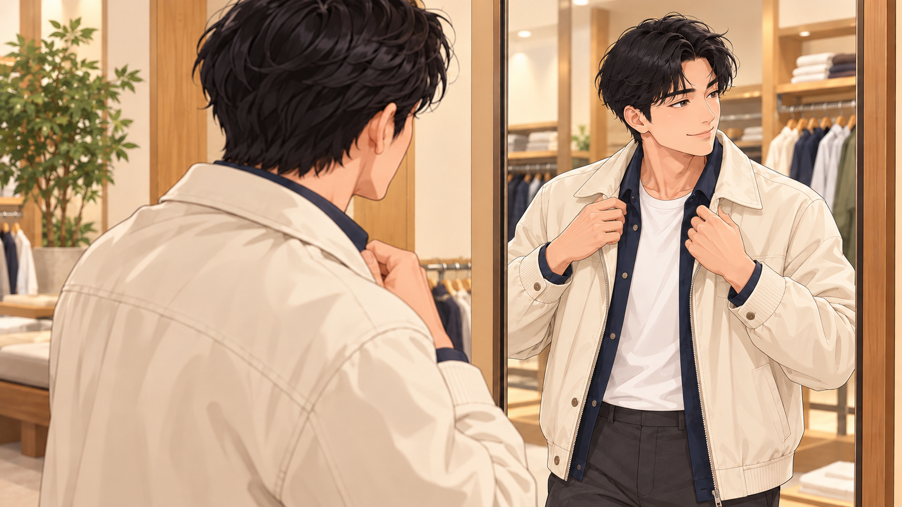 |

## H023 · 첫 후렴: 입장 역전
01:07.866–01:10.500
남자가 두 번째 옷을 손짓해 달라고 한다. 여자는 놀라다 옷을 건넨다.

| START | END |
| --- | --- |
| 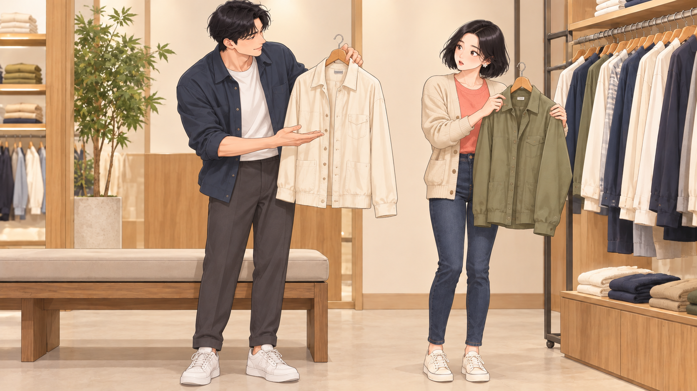 | 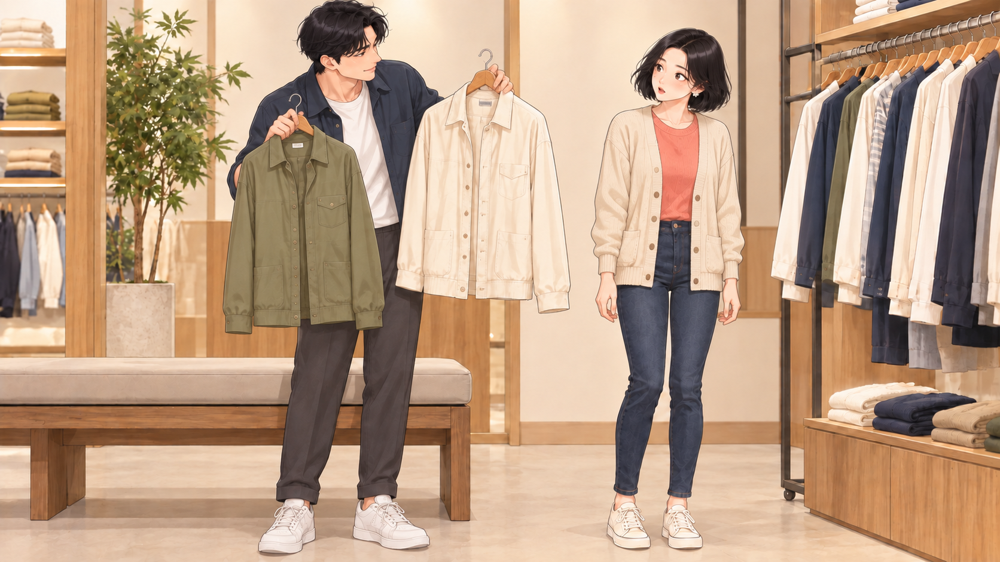 |

## H024 · 투자와 낭비
01:10.500–01:13.133
남자가 옷 두 벌을 자기 몸에 번갈아 대고 진지하게 비교. 여자는 처음엔 재미있게 지켜본다.

| START | END |
| --- | --- |
| 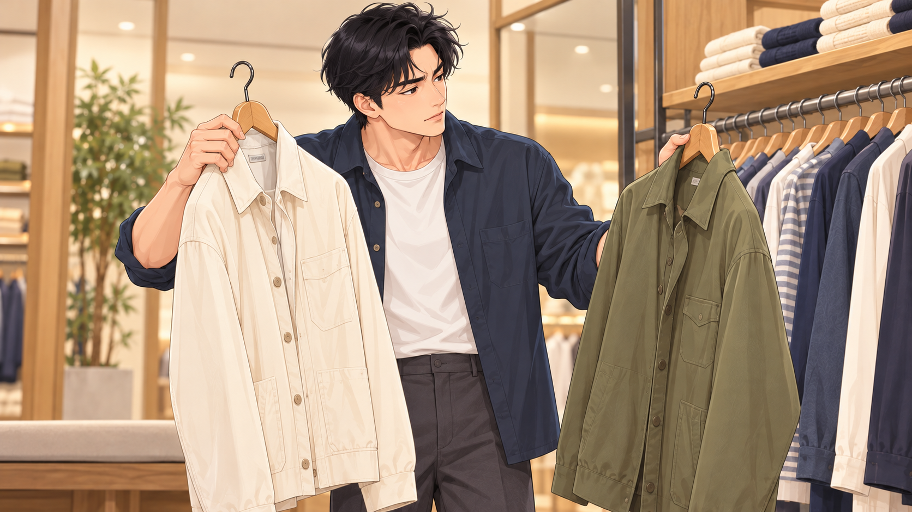 | START 공용 |

## H025 · 하는 건 똑같잖아
01:13.133–01:18.400
도입에서 남자가 앉았던 정확한 벤치에 이번엔 여자가 앉아 있다. 남자 옷 고르기는 계속되고 여자는 천천히 졸기 시작한다.

| START | END |
| --- | --- |
| 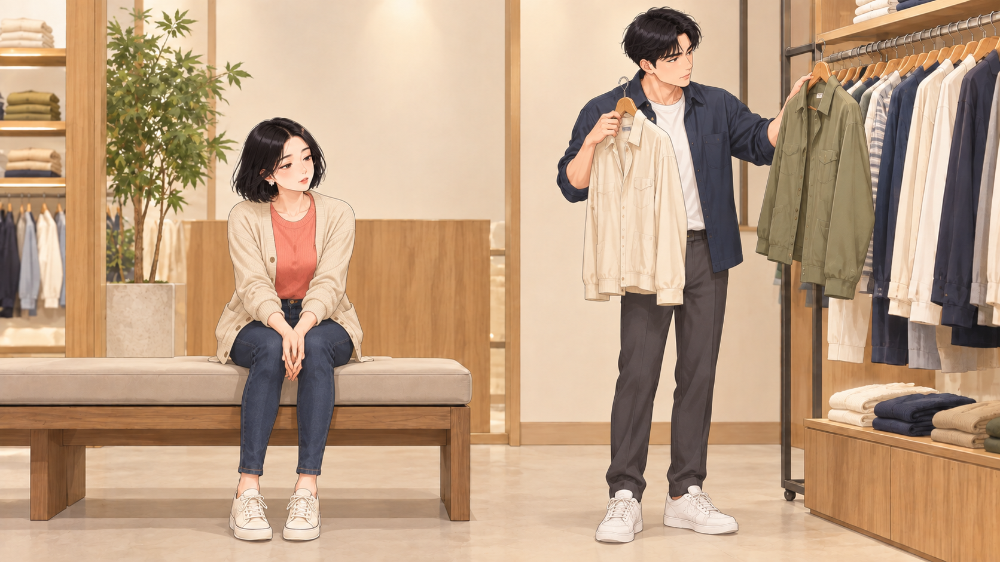 | 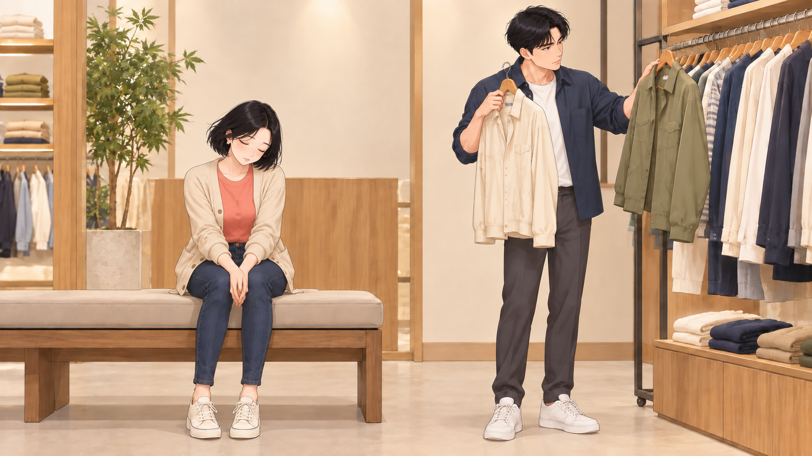 |

## H026 · 내 취미도 소중
01:18.400–01:21.166
게임 중인 여자 옆에서 남자가 과자 봉지를 열어 준다. 여자가 손을 못 떼자 남자가 한 조각을 조심스럽게 건넨다.

| START | END |
| --- | --- |
| 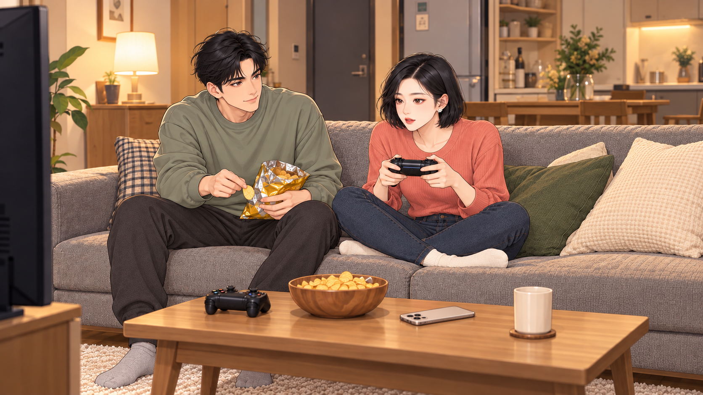 | 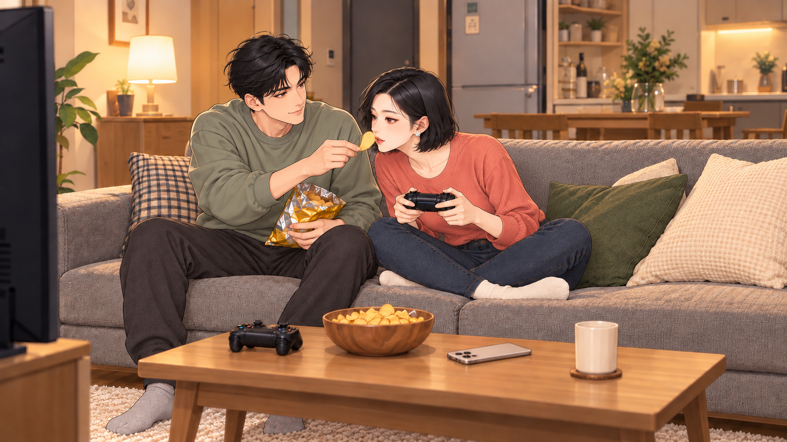 |

## H027 · 누가 쓸데없대
01:21.166–01:24.166
졸던 여자 앞에 옷걸이 하나가 또 들어온다. 여자가 눈을 뜨고 미소를 애써 유지한다.

| START | END |
| --- | --- |
|  |  |

## H028 · 서로 취미활동은
01:24.166–01:27.400
여자가 한 판을 끝내고 패드를 남자에게 넘긴다. 남자가 반갑게 받으려는데 여자가 두 번째 패드를 꺼낸다.

| START | END |
| --- | --- |
| 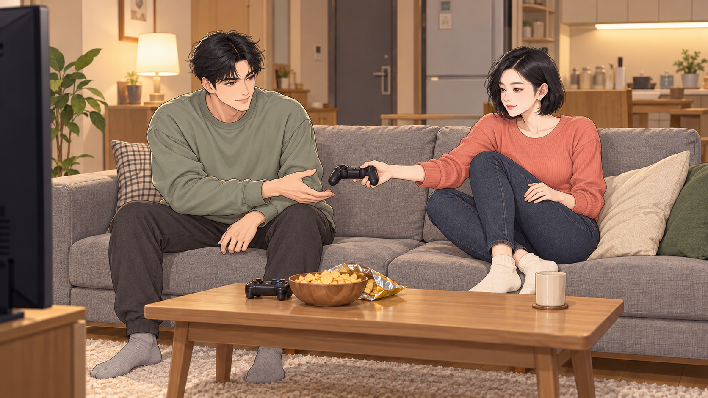 | 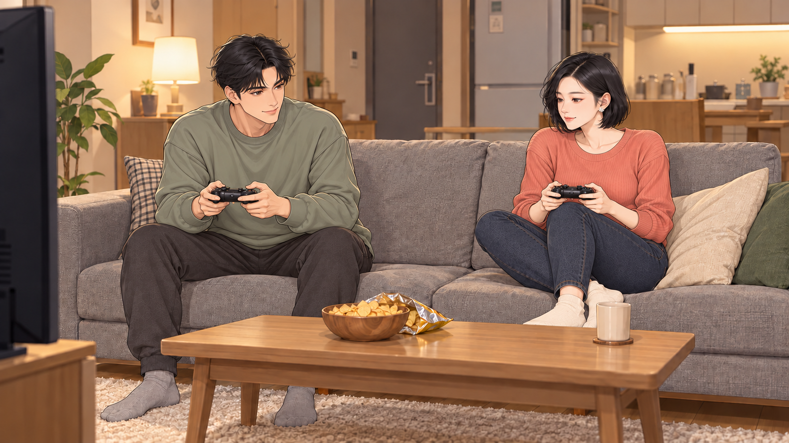 |

## H029 · 보장해 줍쇼
01:27.400–01:29.733
두 패드를 가볍게 맞댄 뒤 각자 화면을 본다. 장난스러운 협력의 미소.

| START | END |
| --- | --- |
| 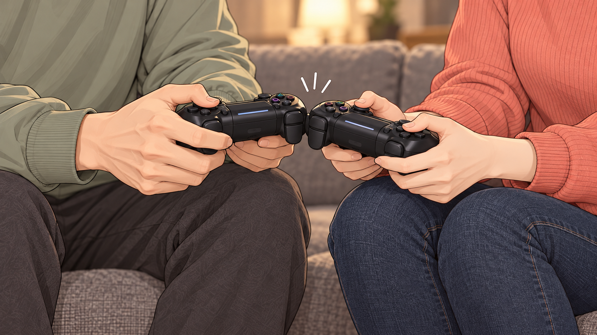 | START 공용 |

## H030 · 내 택배는 필요한 것
01:29.733–01:32.333
두 택배가 나란히 놓인다. 여자 신발과 남자 신발이 양쪽에서 들어오고 각자 자기 상자를 끌어간다.

| START | END |
| --- | --- |
|  |  |
