# 31–40컷 시작·종료 이미지

[전체 자료](README.md)

## H031 · 또 뭘 샀냐고
01:32.333–01:35.000
서로 상자를 열다가 동시에 상대를 쳐다본다. 눈이 마주치자 상자를 조금 숨기다가 멋쩍게 웃고 다시 연다.

| START | END |
| --- | --- |
| 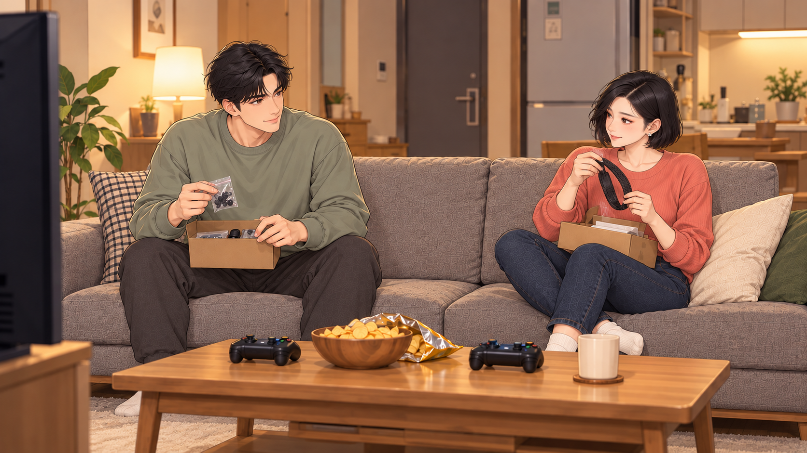 | 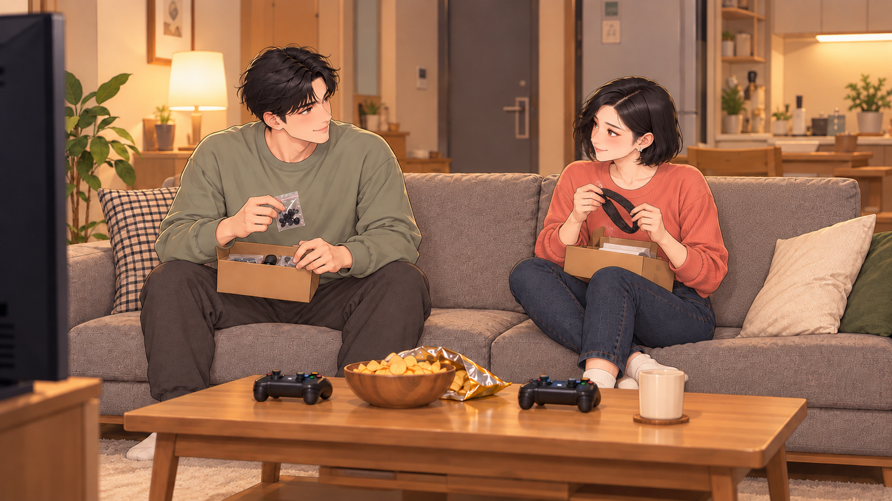 |

## H032 · 여행은 추억
01:35.000–01:37.466
낚시 날. 여자는 여행용 작은 카메라로 강변을 찍으며 걷고 남자는 낚시 가방을 든다.

| START | END |
| --- | --- |
|  | START 공용 |

## H033 · 낚시는 고생?
01:37.466–01:40.333
남자가 작은 접이식 의자를 펴 주는데 여자는 빈 물통을 들여다보며 의심스러운 눈. 남자는 밝게 앉아 찌를 가리킨다.

| START | END |
| --- | --- |
| 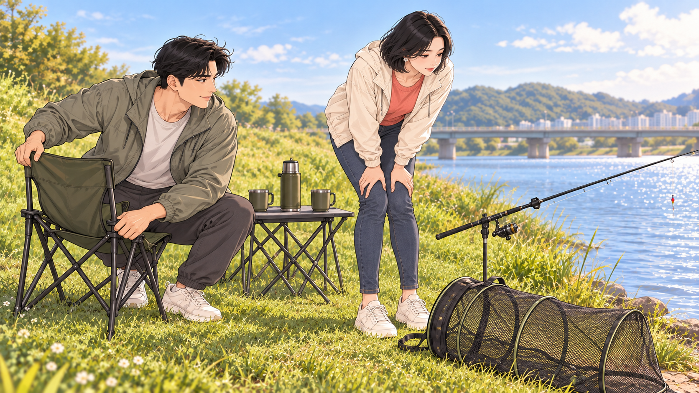 | 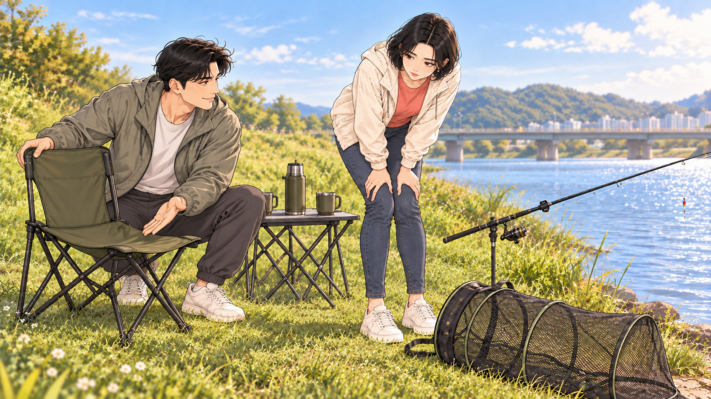 |

## H034 · 나도 알아
01:40.333–01:43.266
뚜껑이 열리고 남녀 얼굴이 위에서 들여다본다. 텅 빈 바닥. 남자는 태연, 여자는 어이없는 미소.

| START | END |
| --- | --- |
| 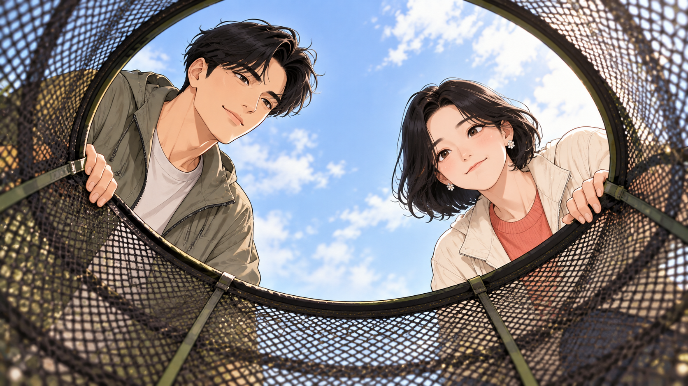 | START 공용 |

## H035 · 한 마리도 못 잡아
01:43.266–01:45.300
정적인 찌 옆으로 작은 잎 하나가 흘러온다. 여자의 그림자가 걸친다.

| START | END |
| --- | --- |
|  | START 공용 |

## H036 · 그래도 내가 좋다잖아
01:45.300–01:49.366
텅 빈 살림망을 옆에 두고 남자가 햇살 속 편하게 웃는다. 뒤쪽 여자는 그 얼굴을 보고 비웃음을 거둔다.

| START | END |
| --- | --- |
| 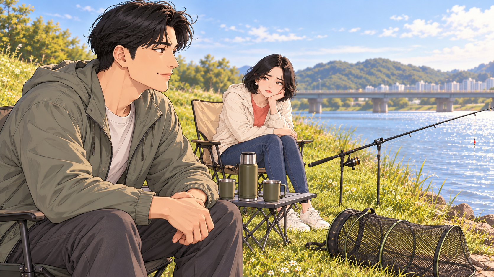 |  |

## H037 · 찌가 움직였다?
01:49.366–01:50.533
찌가 아주 살짝 내려갔다 올라온다. 물고기는 보이지 않는다.

| START | END |
| --- | --- |
| 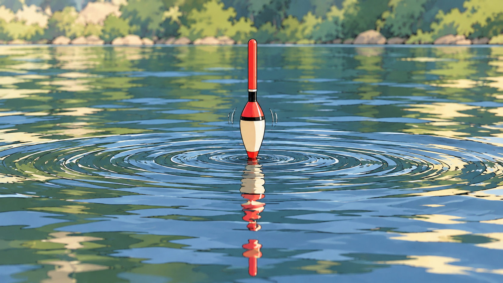 | START 공용 |

## H038 · 잠깐 조용히
01:50.533–01:53.300
시큰둥하던 눈이 크게 열린다. 남자가 말하려 하자 여자가 손바닥을 들고 정지 신호.

| START | END |
| --- | --- |
| 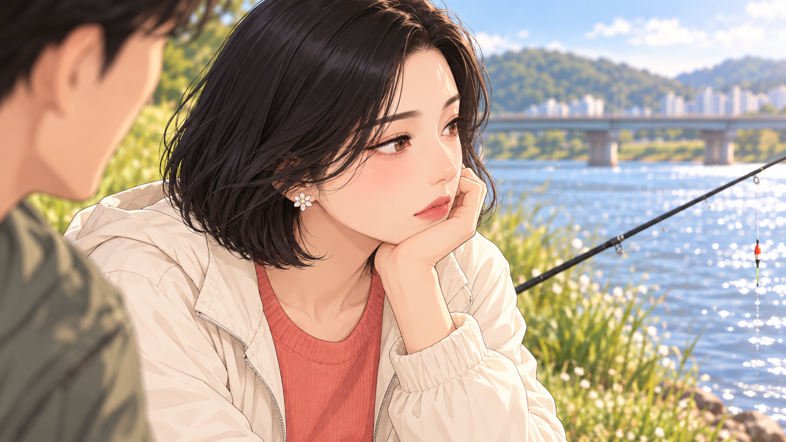 | 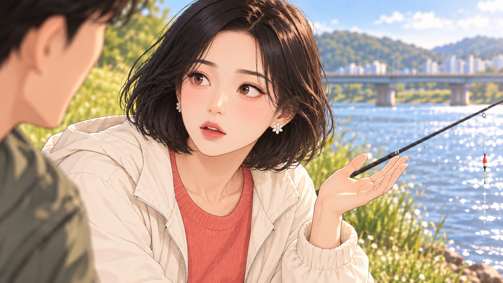 |

## H039 · 잔고는 지키고
01:53.300–01:56.033
새 장비 광고가 켜진 휴대폰을 여자가 잠깐 보다가 내려놓는다. 남자의 기존 낚싯대를 두 손으로 조심히 받아 든다.

| START | END |
| --- | --- |
| 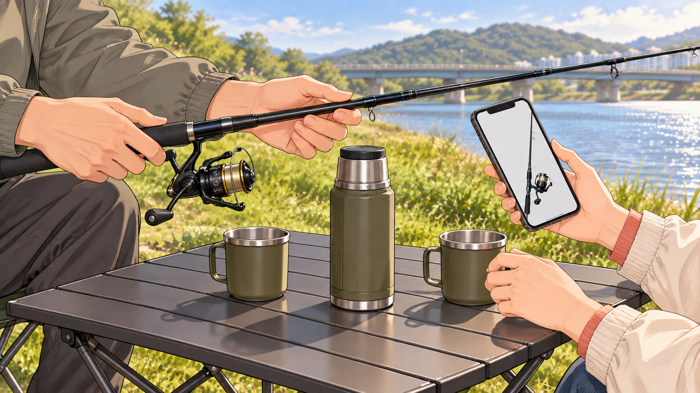 | 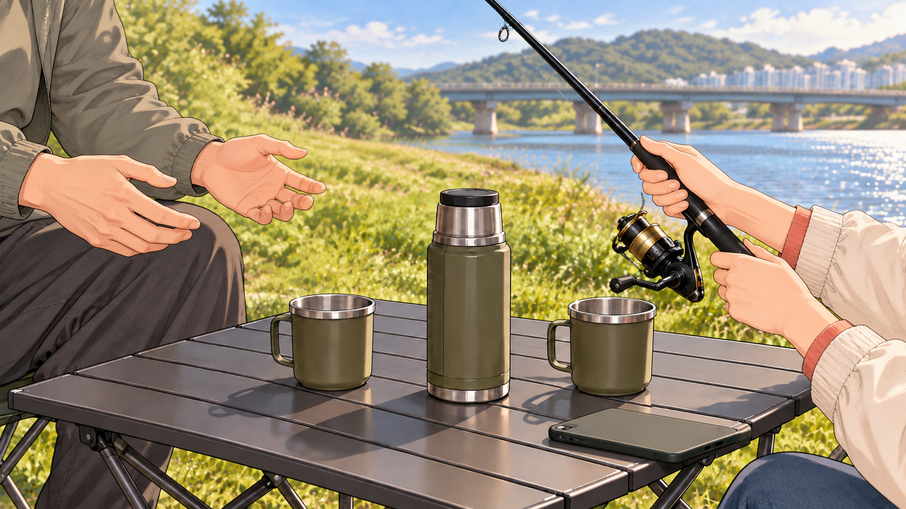 |

## H040 · 웃으면서 넘어가
01:56.033–02:01.066
여자가 낚싯대를 어색하게 잡고 남자는 옆에서 손짓으로 알려 준다. 남자의 웃음에 여자도 웃다가 바로 찌에 집중한다.

| START | END |
| --- | --- |
| 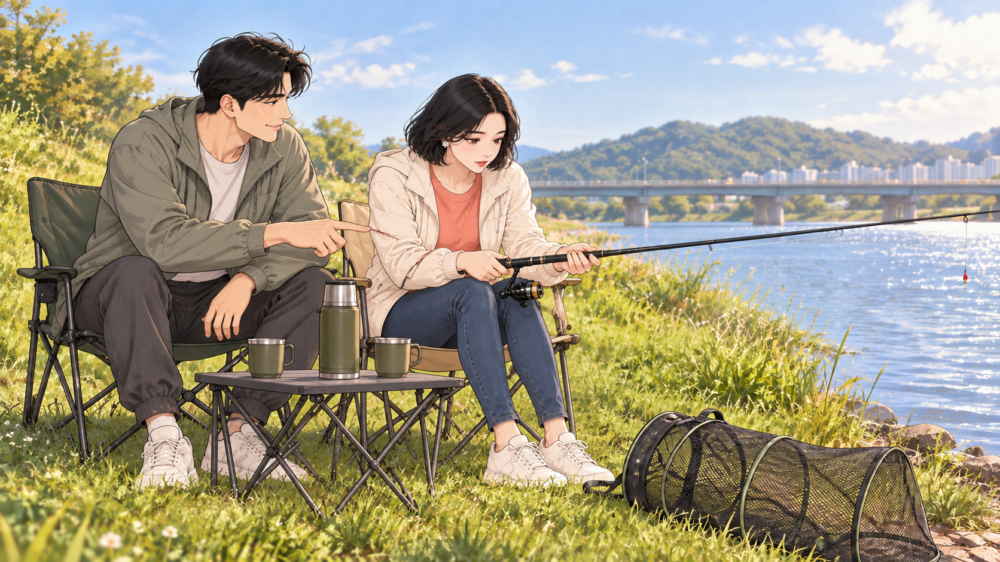 |  |
