# 41–50컷 시작·종료 이미지

[전체 자료](README.md)

## H041 · 너도 신났고
02:01.066–02:06.166
여자가 의자 앞쪽으로 몸을 당긴다. 남자는 자기 의자를 뒤로 조금 빼고 보온병 뚜껑에 차를 따른다.

| START | END |
| --- | --- |
| 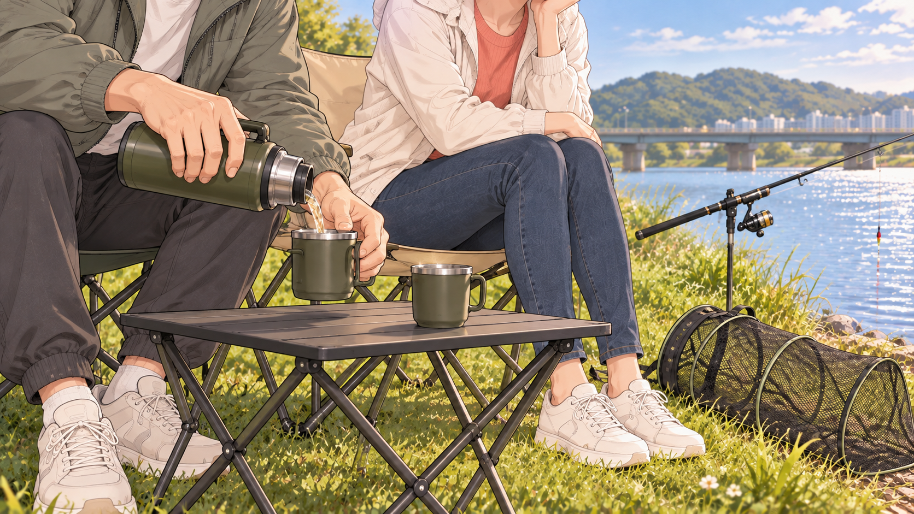 | 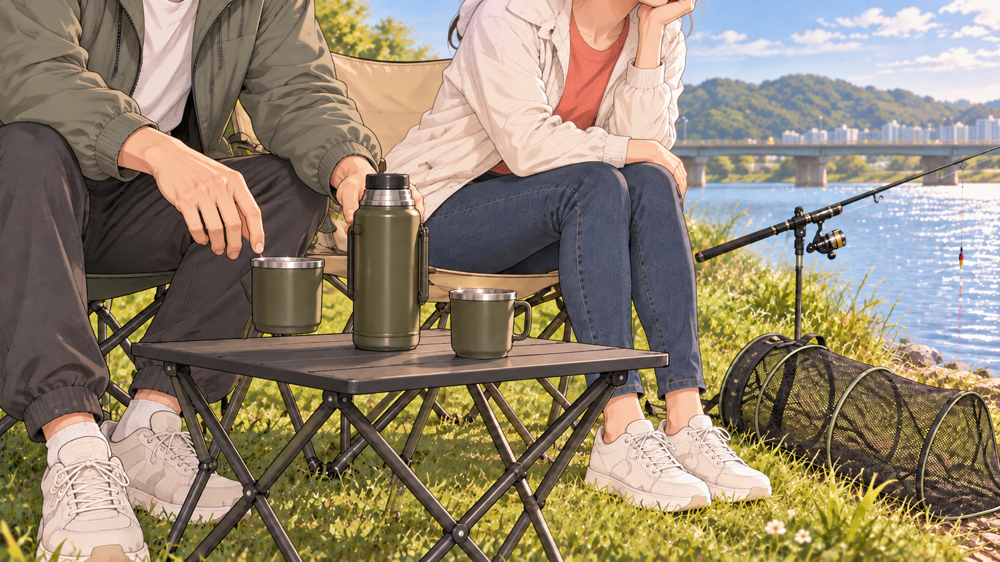 |

## H042 · 그게 취미지
02:06.166–02:11.700
낚싯대 끝이 살짝 떨리자 여자가 미소. 남자는 차를 내밀다가 그녀가 안 받자 자기 컵 옆에 조용히 둔다.

| START | END |
| --- | --- |
| 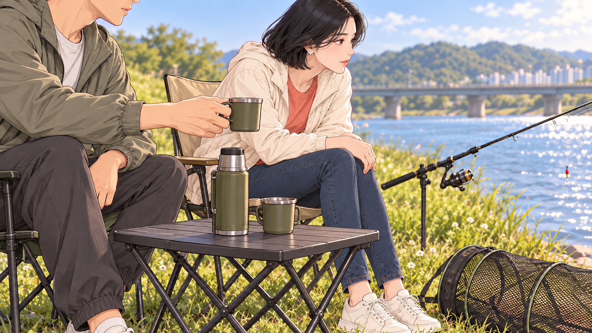 | 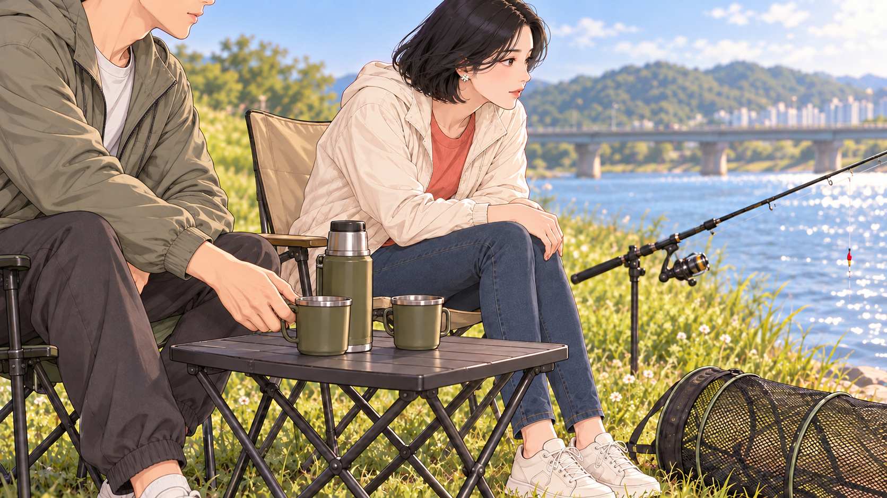 |

## H043 · 다시 투자와 낭비
02:11.700–02:14.133
빛이 약간 낮아지고 여자는 낚시 집중. 남자는 시계를 확인한다. 빈 살림망은 여전히 전경에 보인다.

| START | END |
| --- | --- |
| 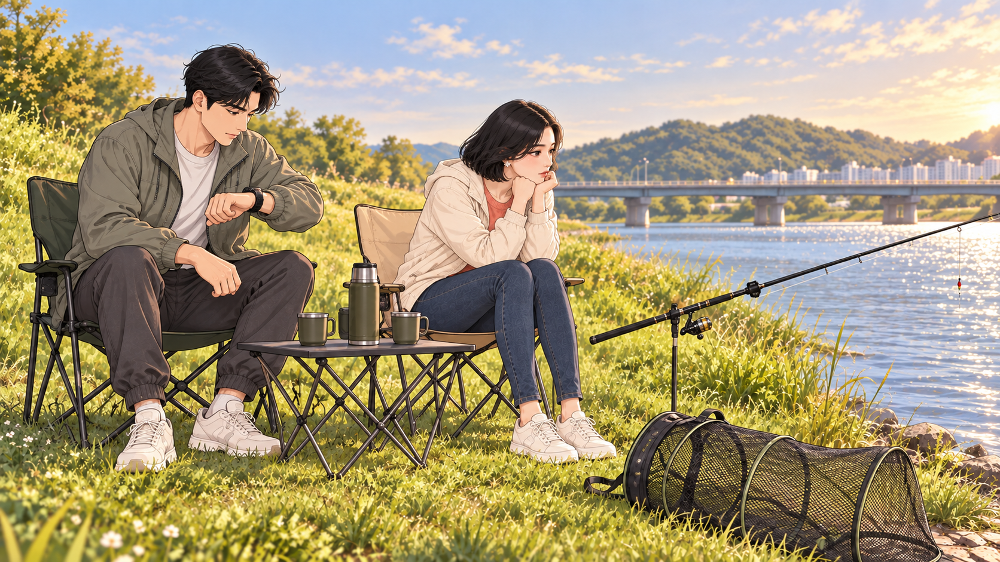 | START 공용 |

## H044 · 이젠 내가 기다린다
02:14.133–02:17.066
남자가 입을 열려다 여자의 손바닥 신호를 예상하고 스스로 입을 닫는다.

| START | END |
| --- | --- |
|  | 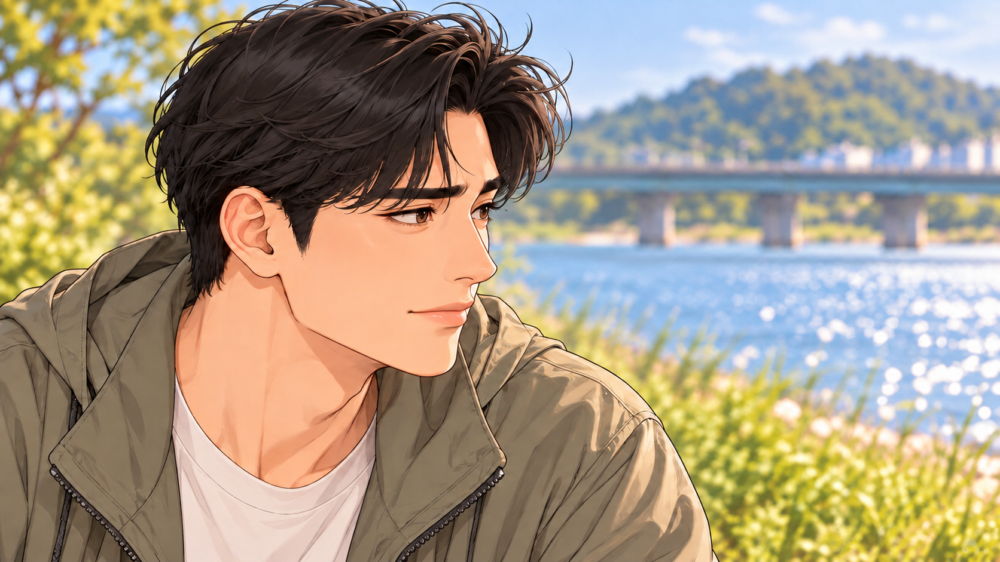 |

## H045 · 똑같잖아
02:17.066–02:22.000
남자가 자기 가방을 정리하자 여자가 낚시 의자 좌판 가장자리를 잡고 몸을 낮춘다. 남자가 멈춰 바라본다.

| START | END |
| --- | --- |
| 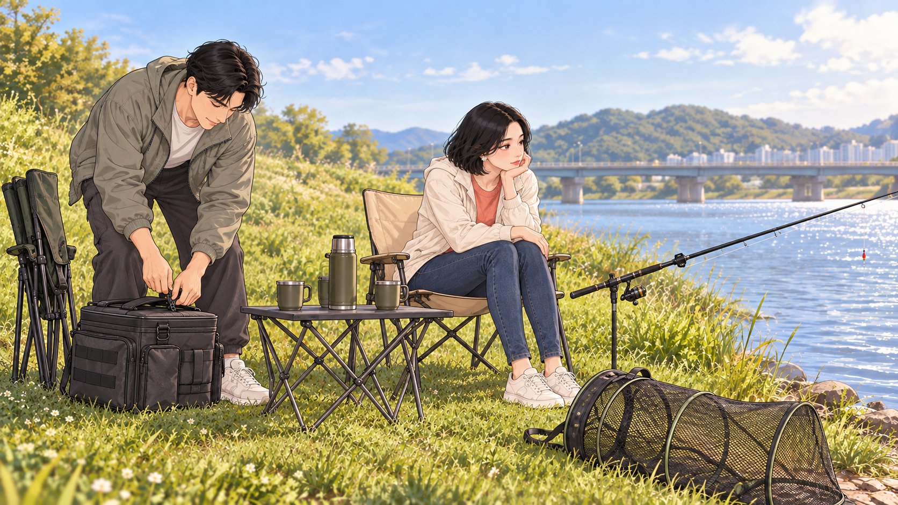 | 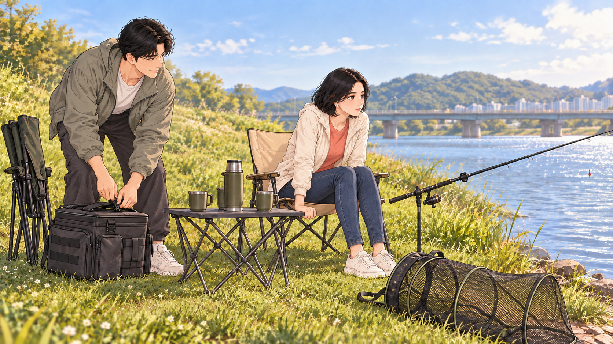 |

## H046 · 네 취미는 힐링
02:22.000–02:24.633
여자가 눈을 피하다 검지 하나를 들어 한 번만 더 신호를 한다. 낚싯대는 받침대에 안정적으로 고정.

| START | END |
| --- | --- |
| 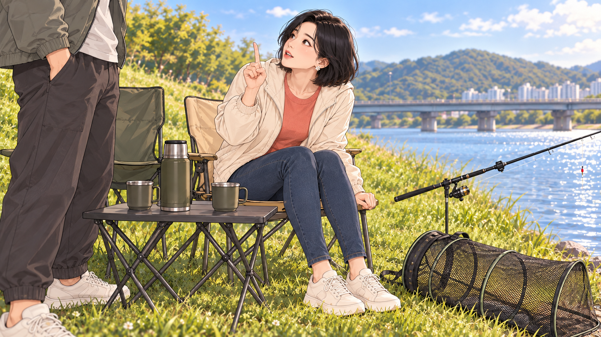 | START 공용 |

## H047 · 내 취미는 돈 낭비?
02:24.633–02:27.266
남자가 다시 의자를 펴고 앉는다. 여자는 곧바로 집중하고 남자는 차를 마시며 체념한 미소.

| START | END |
| --- | --- |
| 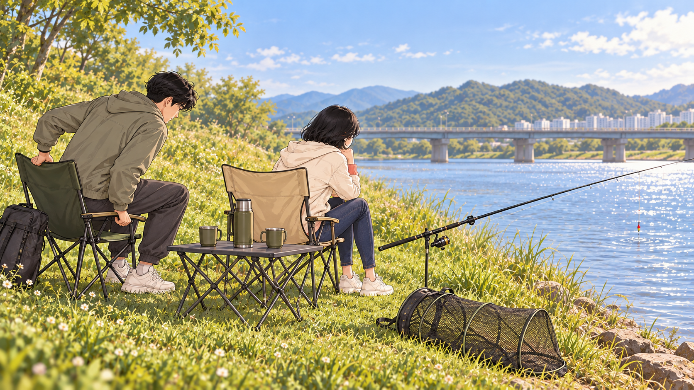 | 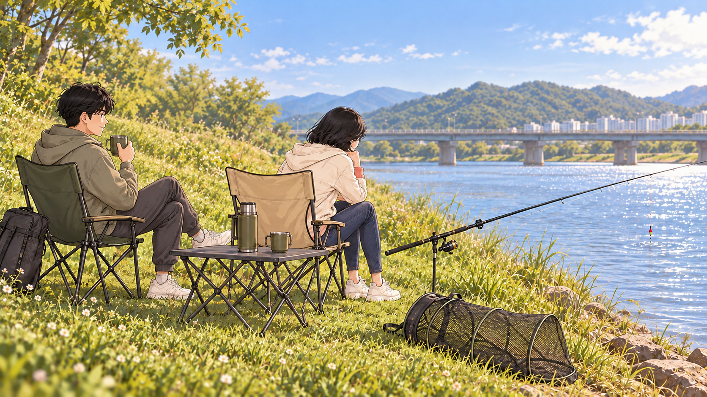 |

## H048 · 공평하게
02:27.266–02:30.933
여자가 남자의 식은 차를 발견하고 새 따뜻한 차를 따라 건넨다. 남자가 받자 둘의 손이 잠깐 닿는다.

| START | END |
| --- | --- |
| 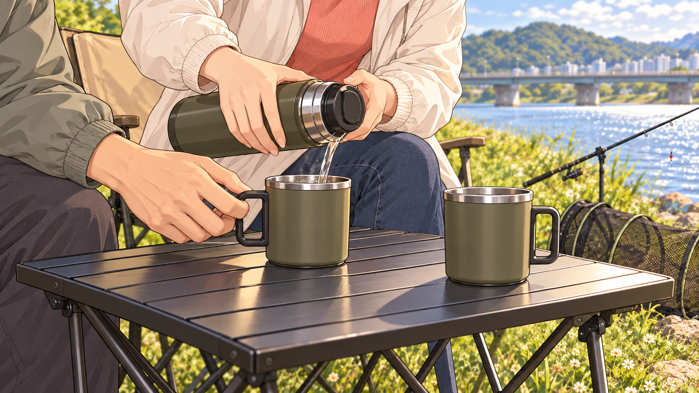 | 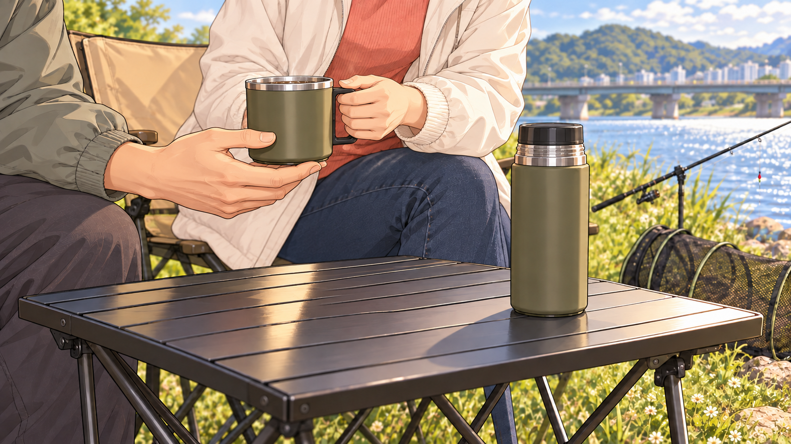 |

## H049 · 보장해 줍쇼
02:30.933–02:33.733
남자는 자기 의자를 여자와 나란히 맞춘다. 둘이 빈 강과 찌를 보며 같이 웃는다.

| START | END |
| --- | --- |
|  | START 공용 |

## H050 · 쇼핑 좋아해? 하세요
02:33.733–02:36.166
다른 날. 남자가 여자의 가벼운 외출 가방을 내밀고 활짝 문을 열어 준다.

| START | END |
| --- | --- |
| 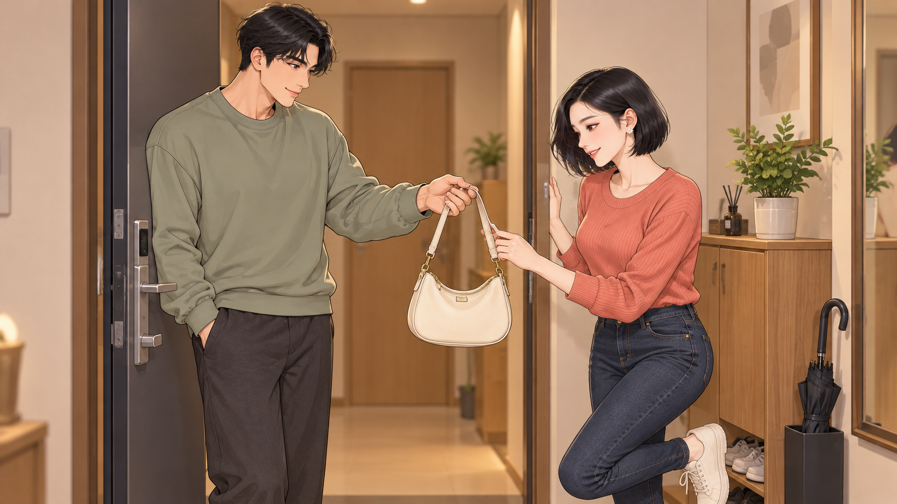 | 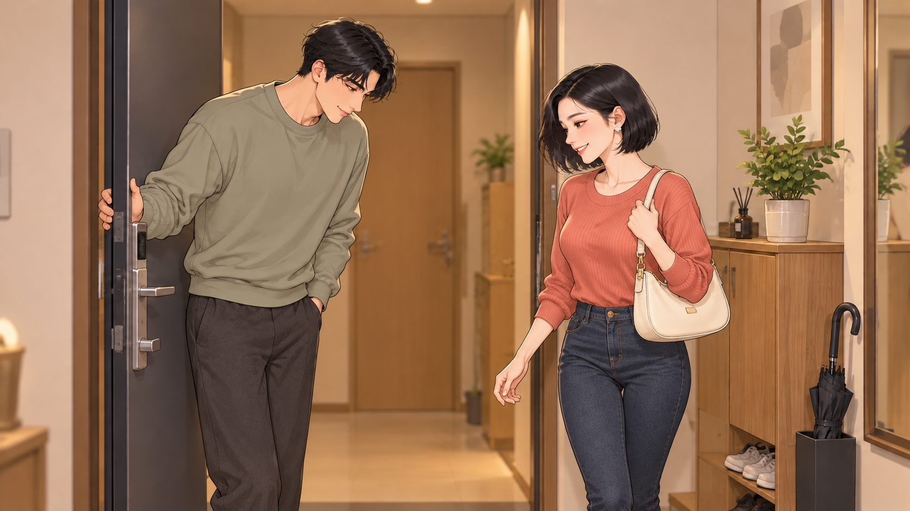 |
