# 11–20컷 시작·종료 이미지

[전체 자료](README.md)

## H011 · 귀환
00:34.700–00:36.766
물컵 든 남자가 돌아오다 멈춘다. 안쪽 여자는 TV 가까이 바짝 앉아 있다.

| START | END |
| --- | --- |
| 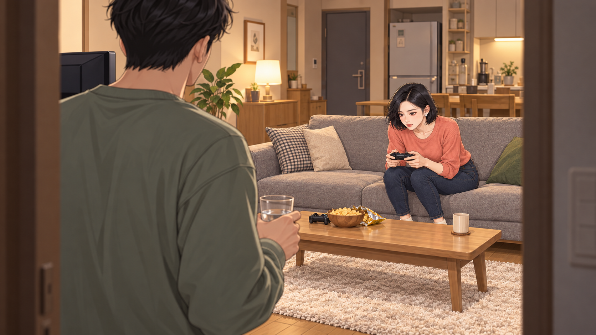 | START 공용 |

## H012 · 옷 한 벌은 기분 전환
00:36.766–00:39.400
다음 날. 여자가 새 재킷을 걸쳐 보고 기분 좋게 회전한다. 남자는 벤치에서 휴대폰을 본다.

| START | END |
| --- | --- |
| 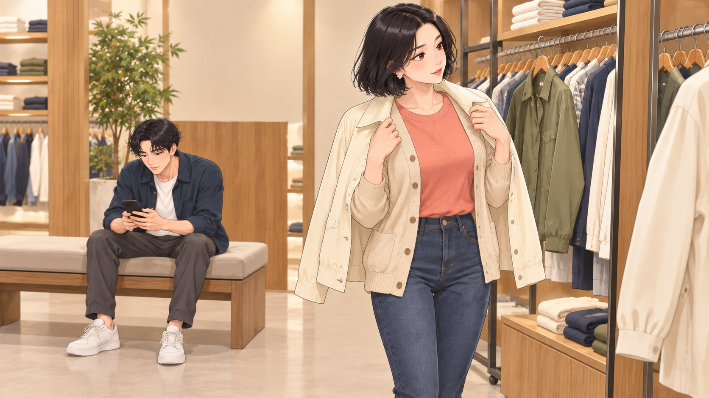 | 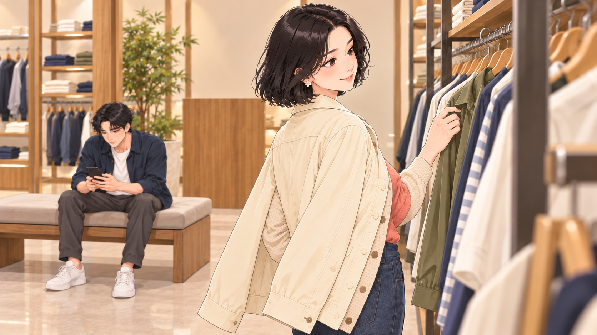 |

## H013 · 게임 한 판은?
00:39.400–00:42.033
앞 저녁으로 돌아와 남자가 손을 내밀지만 여자는 패드를 몸 가까이 당긴다. 자리를 되찾으려던 남자 손이 허공에 남는다.

| START | END |
| --- | --- |
| 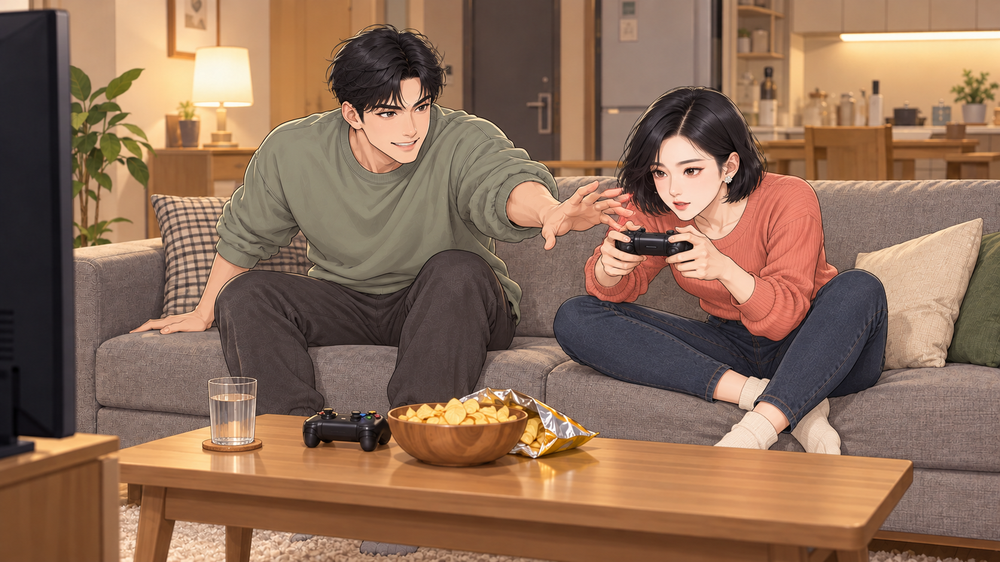 | 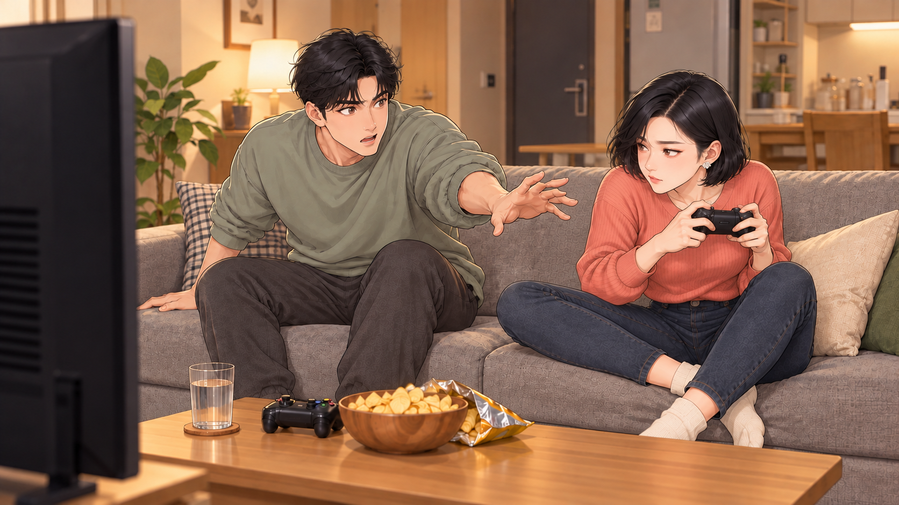 |

## H014 · 카페는 힐링
00:42.033–00:44.700
쇼핑 날 카페. 여자는 음료 사진을 오래 찍고 남자는 컵을 잡은 손을 들고 기다린다.

| START | END |
| --- | --- |
| 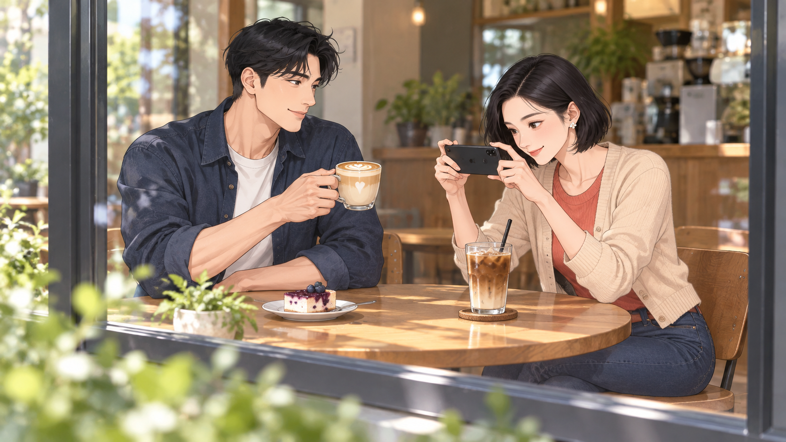 | 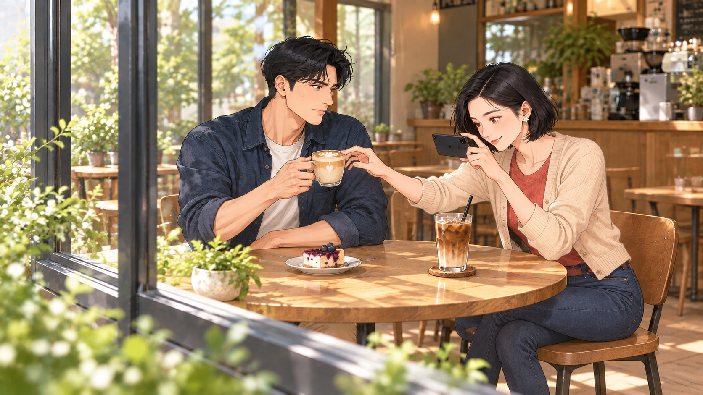 |

## H015 · 친구 만나면 또 놀러?
00:44.700–00:47.333
남자 휴대폰에 친구 셋의 게임 초대 아이콘. 남자 미소를 여자가 슬쩍 보고, 자기 휴대폰의 긴 카페 사진 목록을 의식한다.

| START | END |
| --- | --- |
| 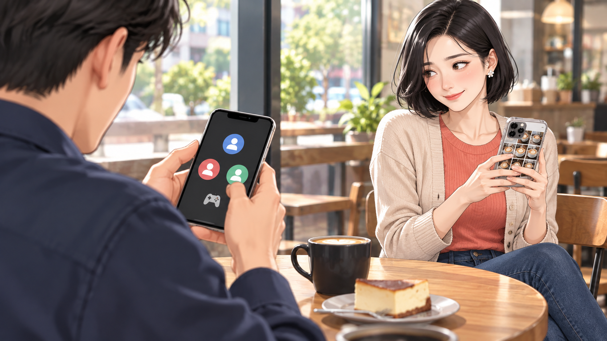 | START 공용 |

## H016 · 잠깐만
00:47.333–00:49.633
남자가 패드와 여자 얼굴을 번갈아 보고, 천천히 자기 가슴을 가리킨다.

| START | END |
| --- | --- |
| 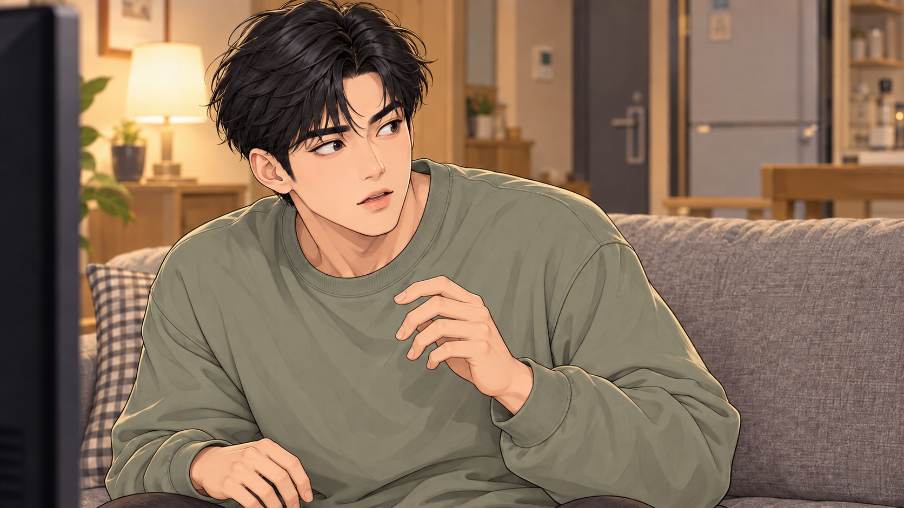 | 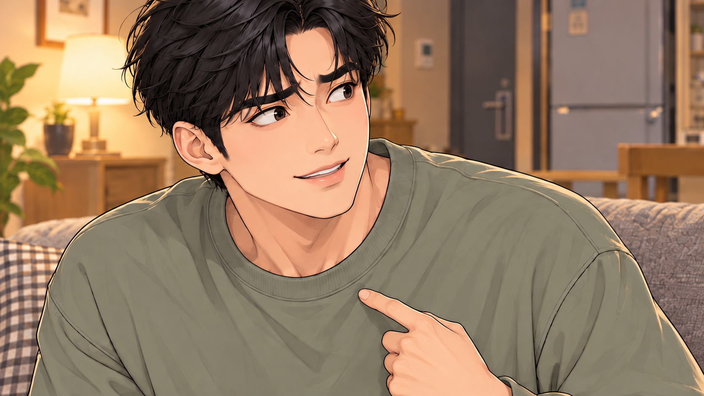 |

## H017 · 지금 중요한 순간
00:49.633–00:52.633
여자는 TV에서 눈을 떼지 않고 손바닥을 들어 조용히 하라는 신호. 남자는 물컵 든 채 입을 다문다.

| START | END |
| --- | --- |
| 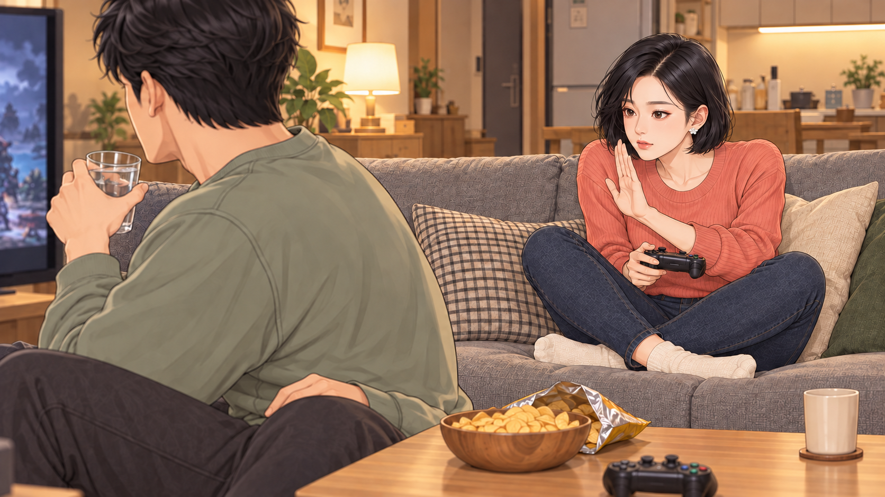 | 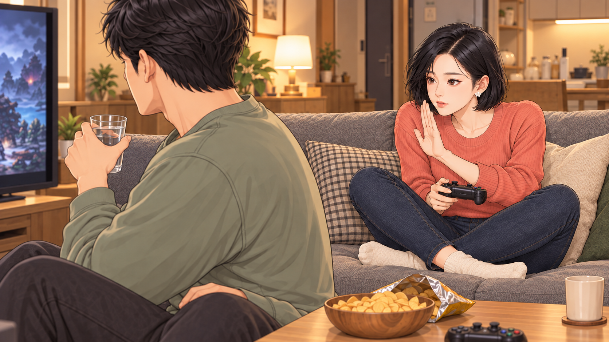 |

## H018 · 조금 다른 것뿐
00:52.633–00:55.333
여자가 실패하자 남자는 웃음을 참는다. 여자가 눈만 흘기자 남자는 즉시 진지한 응원 표정으로 바꾼다.

| START | END |
| --- | --- |
| 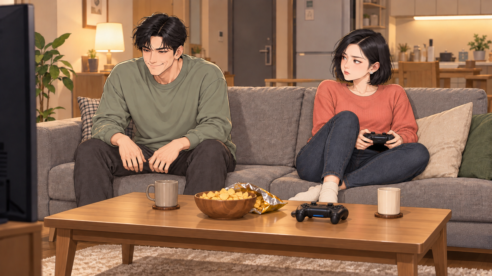 | 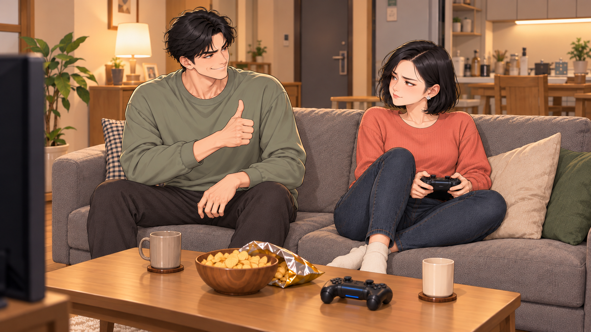 |

## H019 · 맞고 틀림 없음
00:55.333–00:57.900
남자가 빼앗지 않고 허공에서 버튼 순서를 시범. 여자가 그대로 눌러 성공한다.

| START | END |
| --- | --- |
| 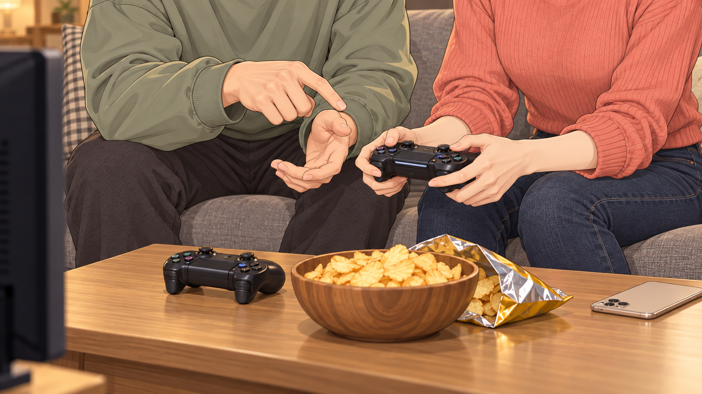 | START 공용 |

## H020 · 너도 하고
00:57.900–01:00.566
여자가 성공하며 주먹을 들고, 남자는 옆에서 작게 만세. 역할이 자연스럽게 선수와 응원단으로 바뀐다.

| START | END |
| --- | --- |
| 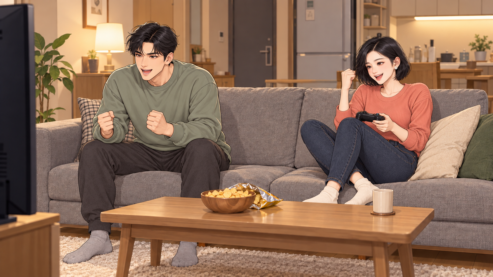 | 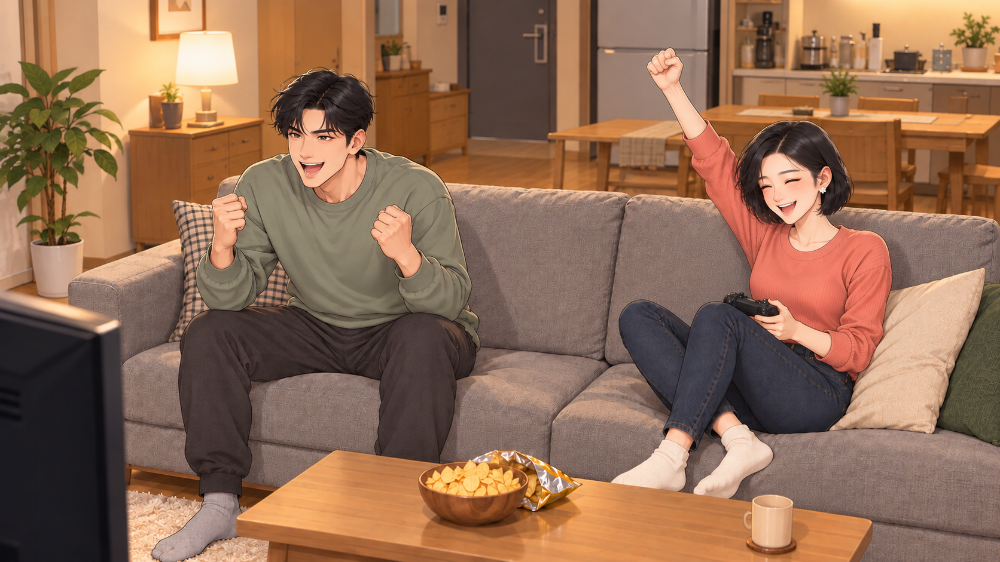 |
