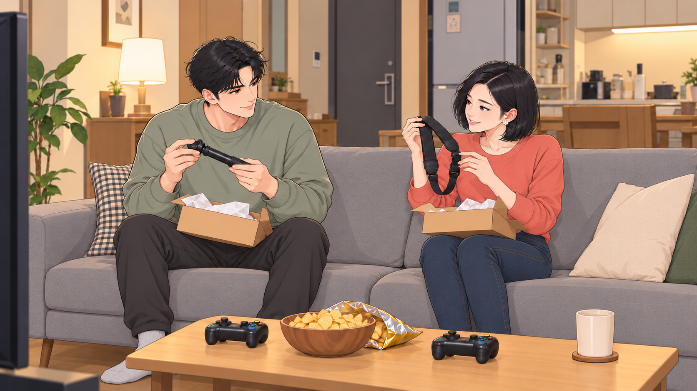

# 인체 연결 수정 · 2026-10-31

전체 134장의 인물 팔·다리 연결을 살펴보고, 앉은 다리와 발의 연결이 혼동되는 두 장면의 시작·종료 이미지를 교체했습니다.

| 컷 | 음원 구간 | 교체 파일 | 수정 |
|---|---|---|---|
| H013 | 00:39.400–00:42.033 | H013_START.png / H013_END.png | 여주의 복잡하게 접힌 다리를 무릎과 정강이 연결이 명확한 앉은 자세로 수정. 남주의 바지·발 연결도 정리. |
| H069 | 03:32.900–03:36.000 | H069_START.png / H069_END.png | 첨부 화면의 택배 개봉 장면. 여주의 겹쳐 보이는 다리를 두 무릎이 나란한 자세로 수정하고 남주의 다리·발 연결도 정리. |

확정한 얼굴·머리·의상과 게임기·택배 소품의 행동을 유지하는 부분 수정입니다. 원본 파일명과 컷 시간은 그대로 사용합니다.

- [수정 이미지 4장만 다운로드](anatomy-fixes.zip)
- [음원 미리보기 MP4](full-song-preview.mp4)
- 전체 이미지 묶음 중 part2(H011–H020), part7(H061–H070)에도 동일한 파일을 반영했습니다.
- 추가 팔다리로 오인될 수 있는 접힌 다리 실루엣을 줄였습니다. 테이블이나 다른 인물에 자연스럽게 가려진 팔다리는 그 자체로 오류로 판단하지 않았습니다.

## 수정 이미지

### H013 시작

### H013 종료

### H069 시작

### H069 종료

