# 31–40컷 시작·종료 이미지

[전체 자료](README.md)

## H031 · 또 뭘 샀냐고
01:32.333–01:35.000
서로 상자를 열다가 동시에 상대를 쳐다본다. 눈이 마주치자 상자를 조금 숨기다가 멋쩍게 웃고 다시 연다.

| START | END |
| --- | --- |
| 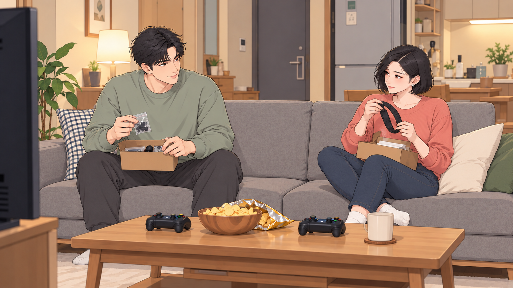 | 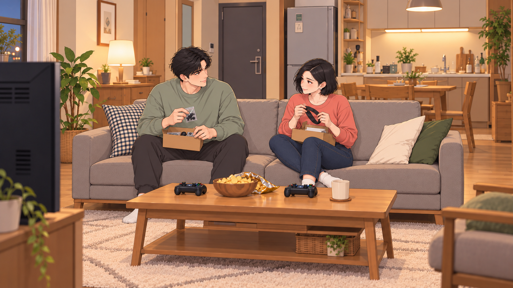 |

## H032 · 여행은 추억
01:35.000–01:37.466
낚시 날. 여자는 여행용 작은 카메라로 강변을 찍으며 걷고 남자는 낚시 가방을 든다.

| START | END |
| --- | --- |
| 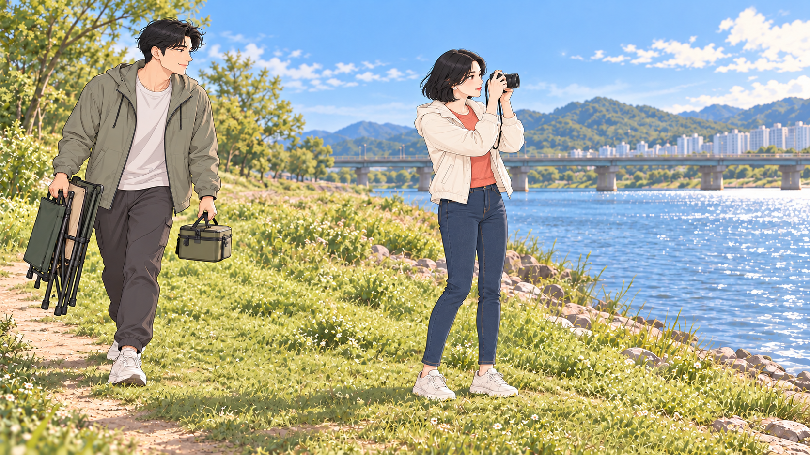 | 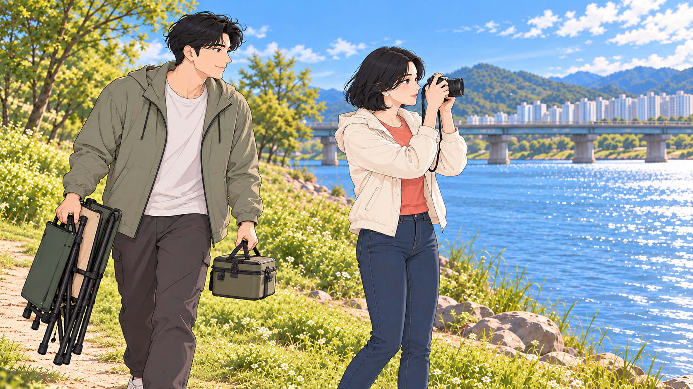 |

## H033 · 살림망은 물속으로
01:37.466–01:40.333
남주가 살림망을 물에 넣고 입구를 고정한다. 여주는 옆에서 지켜본다.

| START | END |
| --- | --- |
| 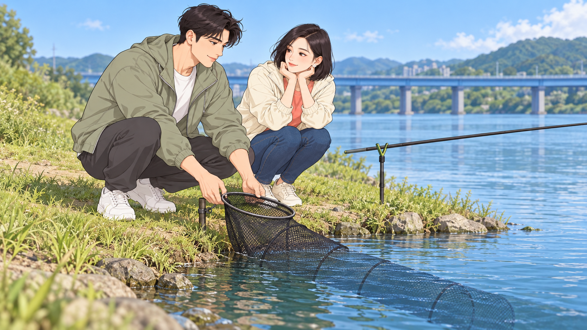 | 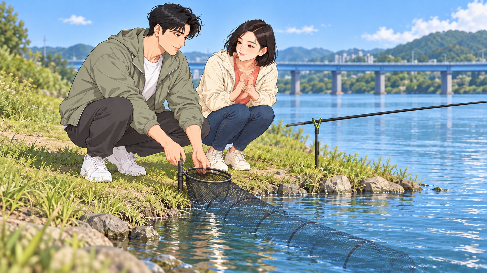 |

## H034 · 아직 빈 살림망
01:40.333–01:43.266
아직 빈 살림망이 수면 아래 잠겨 있는 것을 짧게 보여준다.

| START | END |
| --- | --- |
| 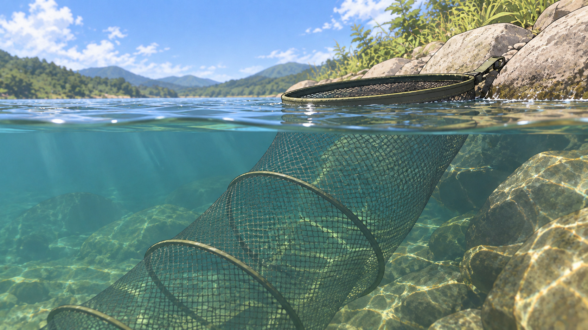 | START 공용 |

## H035 · 조용한 찌
01:43.266–01:45.300
찌 독립 인서트 1: 아직 조용한 수면.

| START | END |
| --- | --- |
| 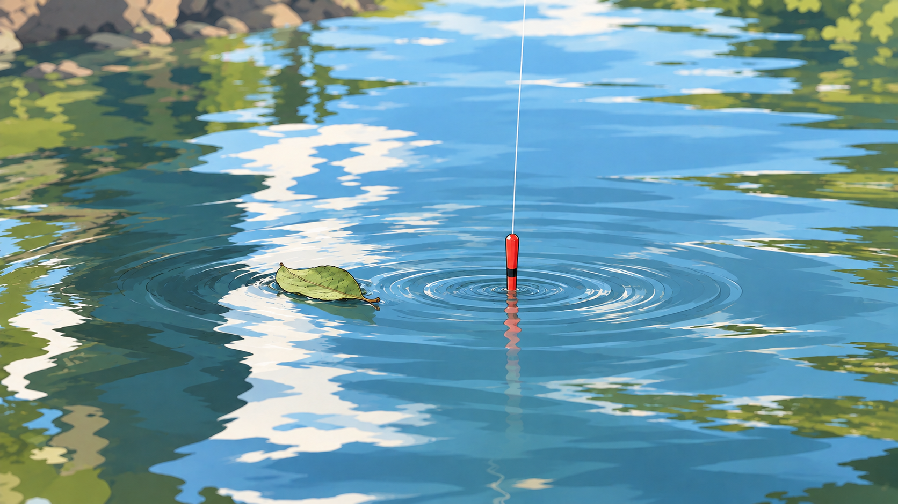 | START 공용 |

## H036 · 그래도 내가 좋다잖아
01:45.300–01:49.366
기다림을 즐기는 남주와 아직 시큰둥한 여주를 대비한다.

| START | END |
| --- | --- |
| 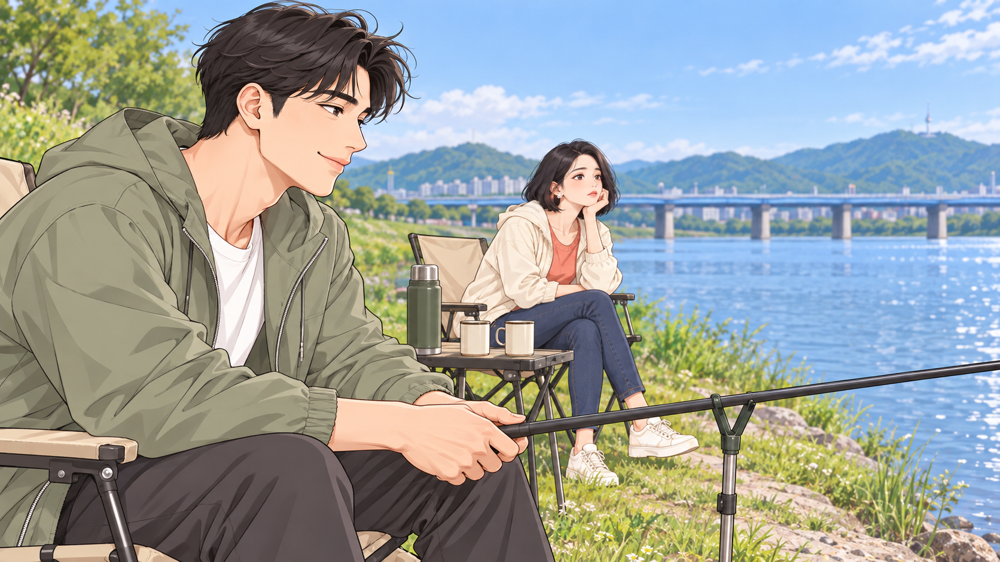 | 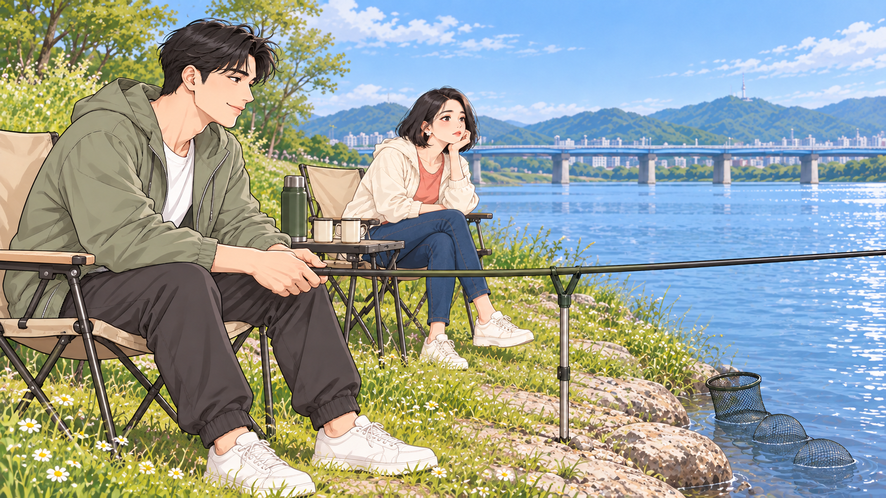 |

## H037 · 어, 움직였다
01:49.366–01:50.533
찌 독립 인서트 2: 찌톱이 낮아지고 작은 파문이 생겨 입질을 예고한다.

| START | END |
| --- | --- |
| 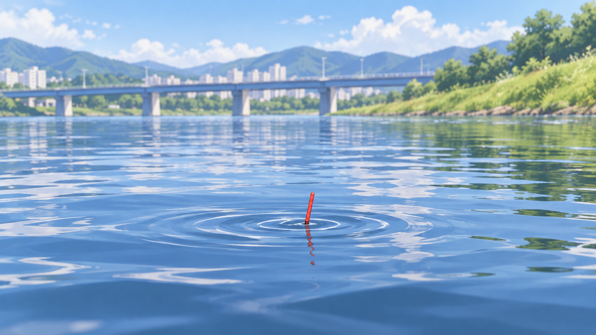 | START 공용 |

## H038 · 눈빛이 달라진다
01:50.533–01:53.300
입질을 본 여주 눈빛이 달라지고 손이 낚싯대 쪽으로 간다.

| START | END |
| --- | --- |
| 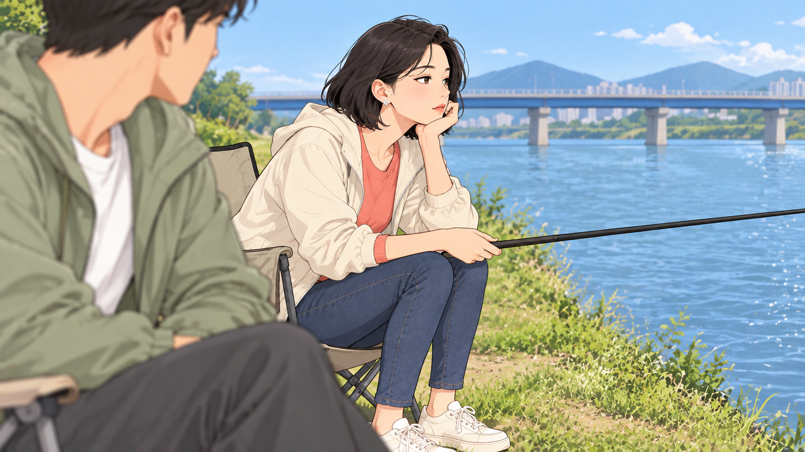 | 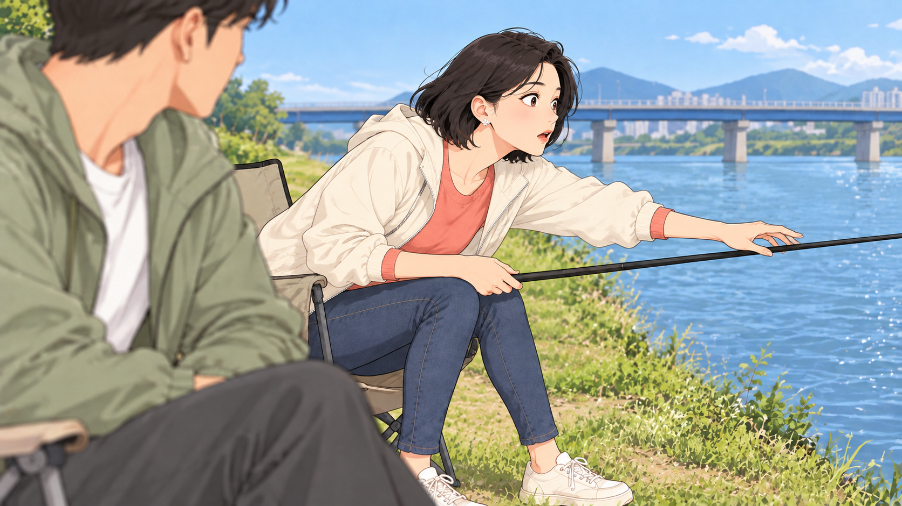 |

## H039 · 내가 잡아볼게
01:53.300–01:56.033
여주가 받침의 민장대를 들어 올리고 남주는 손잡이를 잡는 위치를 알려준다.

| START | END |
| --- | --- |
| 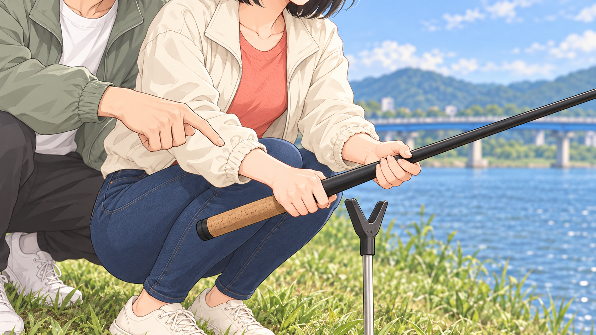 | 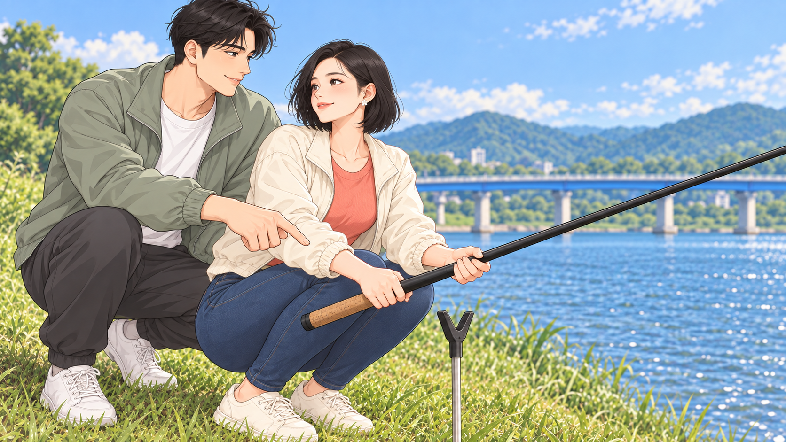 |

## H040 · 서툰 낚시 수업
01:56.033–02:01.066
서툰 여주가 낚싯대를 들고 남주의 설명에 웃는다.

| START | END |
| --- | --- |
| 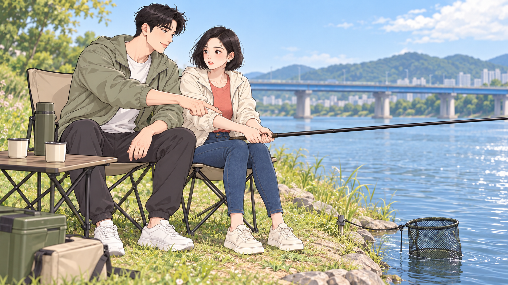 | 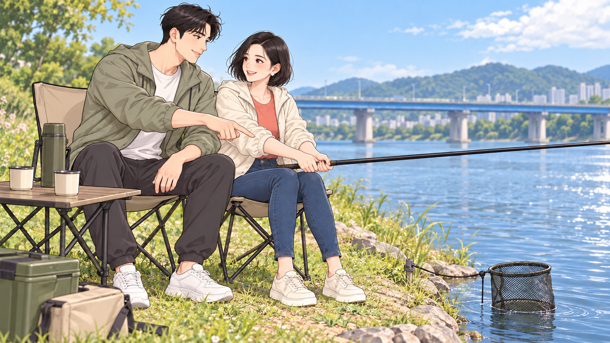 |
