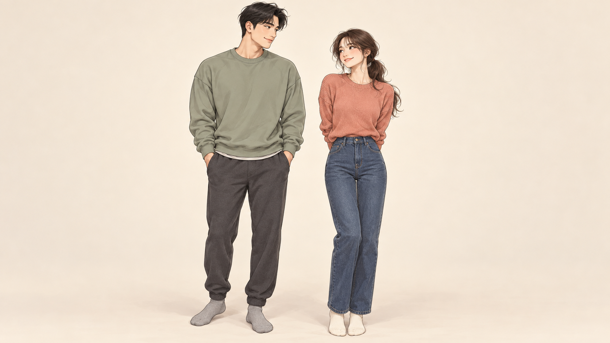
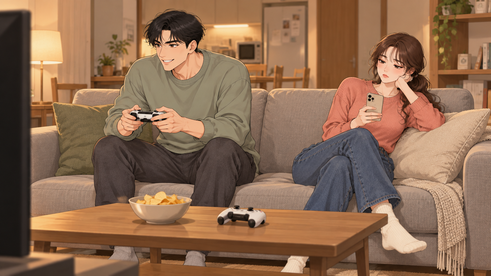
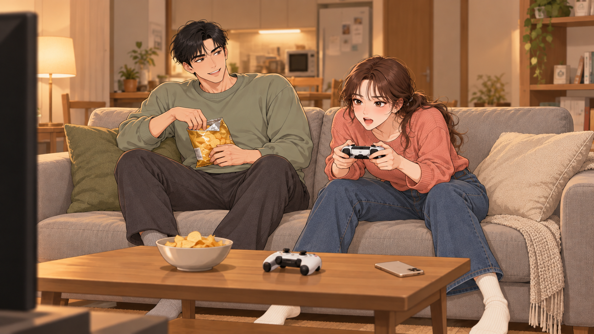
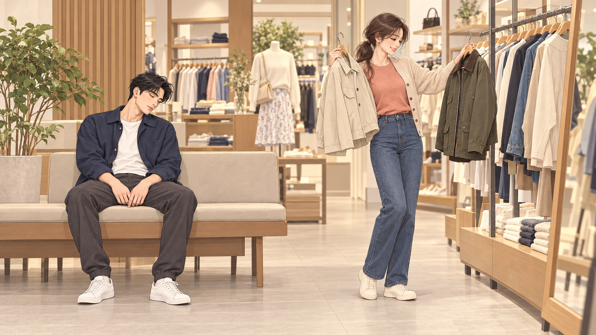
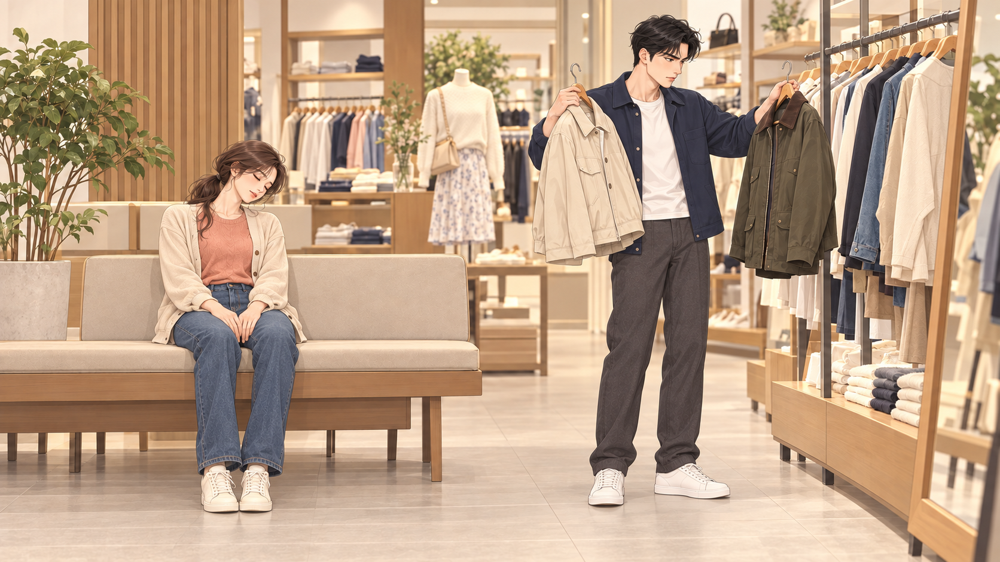
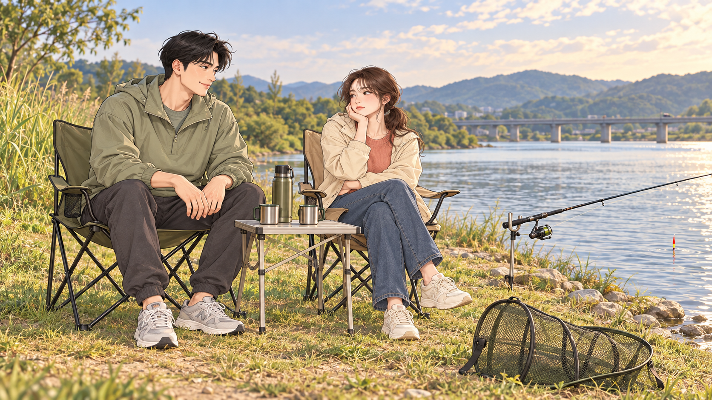
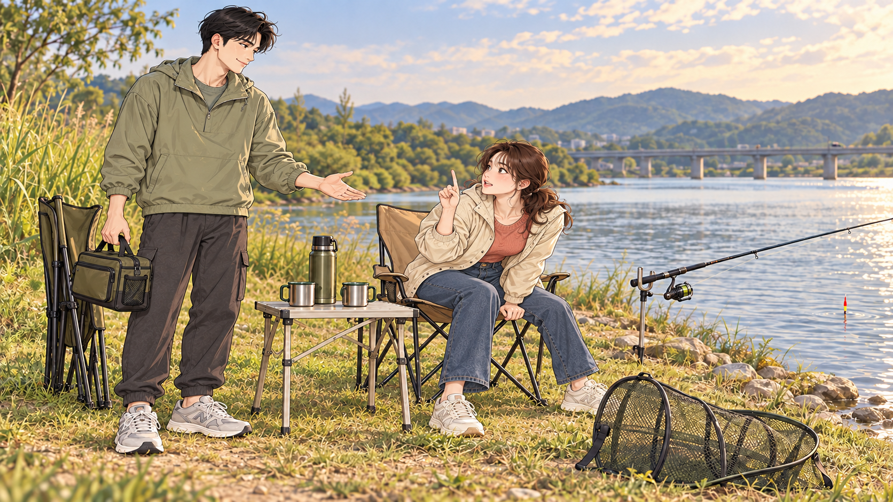

# 취미 활동은 보장해 줍쇼 · 커플 / 꽁트 테스트 v1

캐릭터 제안 1장 + 세 에피소드의 전후 이미지 6장, 총 7장입니다. **캐릭터 디자인과 그림체는 아직 사용자 확정 전입니다.** 아래 이미지에서 상황의 역전이 읽히는지 확인하는 단계입니다.

[테스트 전체 ZIP 다운로드](https://github.com/dbtjs4848-lgtm/-/raw/refs/heads/main/hobby-guarantee/test-v1/hobby-test-v1.zip) · [비교 PDF 다운로드](https://github.com/dbtjs4848-lgtm/-/raw/refs/heads/main/hobby-guarantee/test-v1/comparison.pdf) · [71컷 콘티](../v1/storyboard.md)

## 커플 디자인 제안

한국 성인 30대 초반 커플. 여자는 긴 갈색 낮은 묶음머리와 코랄색 니트, 남자는 짧은 검은 머리와 세이지색 상의. 매력적인 일상 인물에 과장된 몰입·지루함·기다림의 연기를 붙이는 방향입니다.

## 1. 게임: 무관심한 여자 → 몰입한 여자 / 남자는 기다리는 사람

TV 쪽에서 보는 같은 구도와 좌우 자리를 유지합니다. 뒤로 기대 휴대폰을 들던 여자가 앞으로 바짝 기울어 패드를 잡고, 남자는 과자 담당이 됩니다. 표정만 바꾸지 않고 상체·손·소품의 역할을 함께 바꿨습니다.

| 전: 남자가 게임, 여자는 시큰둥 | 후: 여자가 몰입, 남자는 과자를 들고 기다림 |
| --- | --- |
|  |  |

## 2. 쇼핑: 졸던 남자 → 옷을 고르는 남자 / 여자가 벤치에서 대기

벤치와 옷걸이 위치는 그대로 두고 두 사람의 위치와 역할을 교환합니다. 닮은 프레임에서 기다리는 사람이 바뀌는 것이 펀치입니다.

| 전: 옷을 고르는 여자, 졸고 있는 남자 | 후: 옷을 고르는 남자, 졸고 있는 여자 |
| --- | --- |
|  |  |

## 3. 낚시: 지루한 여자 → 한 번만 더 / 남자는 돌아갈 준비

여자가 찌를 향해 몸을 당기고 검지로 한 번만 더를 요청합니다. 남자는 짐과 접은 의자를 들고 기다립니다. 빈 살림망을 유지하여 물고기를 잡아야만 즐거운 이야기가 되지 않게 합니다.

| 전: 여자는 지루하고 남자는 여유로움 | 후: 여자는 더 하고 싶고 남자는 귀가 대기 |
| --- | --- |
|  |  |

## 이 테스트의 범위

BEFORE/AFTER는 에피소드의 역할 역전을 비교하는 시험 이미지입니다. 71컷 각각의 START/END 파일이 아니며, 사이에 필요한 호기심·시도·리액션 컷은 기존 콘티에 설계돼 있습니다. 아직 영상 모션이나 립싱크를 생성하지 않았습니다. 물건의 작은 위치·주름 차이는 이후 연속 컷 제작 때 맞춰야 합니다.

확인할 점은 두 인물의 외모·그림체, 자막 없이 읽히는 역할 역전, 표정과 몸짓의 과장 정도입니다. 이 방향을 사용자에게 확인받은 뒤 본편 캐릭터·의상·공간을 고정하는 단계로 이어집니다.
